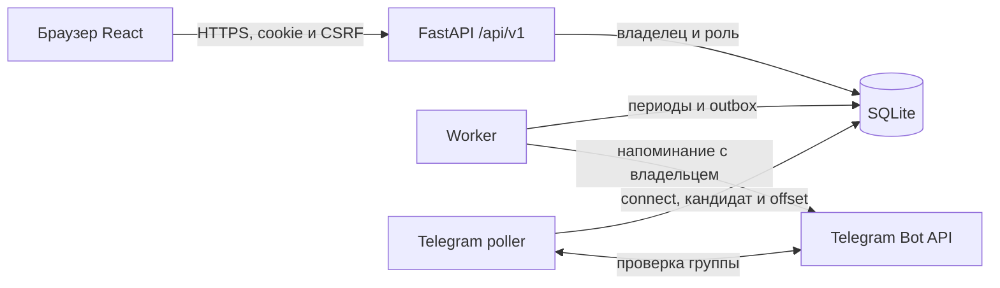

# Руководство Aéza Регулярные платежи

Руководство описывает командную версию, развёрнутую 25 октября 2026. На Windows и Ubuntu прошли 154 теста, TypeScript/Vite пройдены. Корпоративная группа «InKeep» подключена через код и web-подтверждение; Bot API подтвердил две новые отправки. Это не означает прочтение каждым участником. Подробные доказательства — в docs/qa.md.

## 1. Зачем нужен проект

Приложение помогает команде учитывать аренду, подписки, серверы и другие ежемесячные расходы. У каждого расхода есть владелец, сумма, валюта и ближайший срок. Каждый месяц получает отдельную отметку и фактическую дату оплаты.

В одном экземпляре одна команда и одна корпоративная Telegram-группа. Пользователь видит и обслуживает только свои записи, администратор - все. В общую группу приходят напоминания с владельцем, названием, суммой, валютой и сроком. Такая видимость в Telegram согласована отдельно от личной веб-области.

Название продукта - **Aéza · Регулярные платежи**. Бренд, аватар и [@aezainkeep_bot](https://t.me/aezainkeep_bot) сохранены. Расходы не ограничены инфраструктурой Aéza, кабинет и API её биллинга не нужны.

Модуль не принимает платежи, не списывает деньги и не сверяет банк. Пользователь оплачивает расход обычным способом и вручную фиксирует факт. Владелец записи - ответственный за учёт, а не автоматически установленный плательщик по банковской выписке.

## 2. Роли и границы данных

| Действие | Обычный участник | Администратор |
|---|---|---|
| Списки, календарь, история и валютные итоги | Только свои | Все расходы команды |
| Создать расход | Себе | Себе или существующему участнику |
| Изменить будущие условия/прекратить серию | Свою | Любую |
| Отметить/отменить оплату и исправить дату | Свой период | Любой период |
| Управлять участниками и приглашениями | Нет | Да |
| Подключить/отключить Telegram-группу | Нет | Да, с отдельной проверкой Telegram-admin |
| Сменить собственный пароль по текущему | Да, затем повторный вход | Конфигурационный admin меняется только через окружение |
| Изменить конфигурационного admin через API | Нет | Нет |

Ограничения работают на сервере. ID чужой записи, поиск, другой месяц, `owner_id` в JSON или вручную вызванный URL не дают участнику чужие данные. `can_manage` помогает интерфейсу показать доступные действия, но не является клиентским разрешением.

В Telegram все участники подключённой группы могут прочитать опубликованные детали напоминания. Удаление участника из веб-приложения не удаляет его из Telegram-группы. Её состав контролируется отдельно.

## 3. Как добавляются участники

Администратор задаёт логин и отображаемое имя. Есть два самостоятельных способа.

### Создание с паролем

Через управление участниками администратор создаёт обычного пользователя с логином, именем и паролем. Пароль передаётся участнику отдельно, не публикуется в общей группе или презентации. Участник может позднее сменить его в своей учётной записи.

### Одноразовое приглашение

Администратор создаёт приглашение с именем и логином. Ссылка вида `/#invite=TOKEN` действует 72 часа и используется один раз. Получатель задаёт собственный пароль; при успехе создаётся обычный участник и выдаётся новая сессия, поэтому отдельный вход не обязателен.

Имя, логин и роль нельзя произвольно изменить через публичную форму принятия. Приглашение может быть активным, принятым, отозванным или истёкшим. Исходная ссылка возвращается при создании, в списке её повторно нет. На сервере хранится хеш токена. Ссылку следует считать временным секретом и передавать лично адресату.

### Смена пароля

Обычный участник указывает текущий и новый пароль. После успешной смены **все его сессии отзываются**, включая текущую. Нужно войти новым паролем. Это отличается от принятия приглашения, при котором выдаётся fresh session.

Конфигурационный администратор из окружения этим API не меняется. Его пароль восстанавливает оператор через валидный scrypt-хеш в закрытом окружении.

### Удаление участника

Все его серии, включая архивные, переходят конфигурационному администратору в одной транзакции. Идентификаторы и финансовая история сохраняются. Пользователь и его сессии теряют доступ; автор создания не должен заменяться новым владельцем. Это не удаление расходов. Передача и миграция проверены новым набором; обновление сохранило финансовые значения и историю действующей базы.

## 4. Работа в веб-панели

Разделы показывают только разрешённую область. У user это свои расходы, у admin - все.

| Раздел | Для чего нужен |
|---|---|
| Обзор | Месячные итоги по выбранной валюте и ближайшие собственные/доступные сроки |
| Платежи | Поиск, фильтры, отметки, создание и обслуживание серий |
| Календарь | Сроки по дням выбранного месяца; мобильное представление списком |
| История оплат | Прошлые сроки, фактические даты и опоздания |
| Участники | Admin создаёт обычных пользователей и приглашения |
| Журнал | Административные действия и диагностика напоминаний |
| Настройки | Общий часовой пояс и состояние подключения группы |

В навигации раздел участников называется «Пользователи», заголовок экрана — «Участники команды». Рабочая область тёмная с нейтральными серыми панелями; точные текущие снимки находятся в qa/screenshots/team-*.png.

При создании admin может выбрать владельца. Обычный участник создаёт только себе. Для изменения будущих условий задаются название, сумма и валюта; график и история не переписываются. Прекращение серии сохраняет периоды, но останавливает дальнейшее создание и напоминания.

Выбранный месяц относится к **плановому сроку**, а не дате фактического перевода. Оплата январского периода 2 февраля остаётся в январском списке. CSV выгружает разрешённые показанные строки после фильтрации, а не скрытые данные других участников.

## 5. Архитектура и технологии



| Компонент | Технологии и роль |
|---|---|
| Интерфейс | React, TypeScript, Vite, CSS; формы, навигация, таблицы |
| HTTP API | Python, FastAPI, Starlette, Uvicorn; сессии, права, JSON и frontend |
| Валидация | Pydantic; допустимые поля, деньги, даты и строки |
| База | SQLite, WAL, транзакции и внешние ключи на локальном диске |
| Telegram | HTTPX; worker отправляет, poller обрабатывает подключение |
| Конфигурация | Окружение, локальный dotenv, zoneinfo/tzdata |
| Проверки | pytest, TestClient, временные базы и подмена HTTP-транспорта |
| Развёртывание | PowerShell локально, Docker Compose либо Ubuntu/systemd и nginx |

Frontend и API работают с одного origin - схемы, хоста и порта. В production nginx завершает HTTPS и передаёт запрос на внутренний Uvicorn. Собранный frontend не требует Node.js на сервере. Секреты не участвуют в его сборке.

Три процесса независимы: API отвечает браузеру, worker проверяет сроки, poller получает служебные Telegram-обновления. Для небольшой команды на одном хосте SQLite убирает необходимость отдельного сервера базы и брокера очередей. Для нескольких хостов потребуется другая база и координация заданий; такого режима здесь нет.

### Где искать код

| Файл | Ответственность |
|---|---|
| `backend/app.py` | Маршруты, авторизация, CSRF, заголовки, Swagger и SPA |
| `backend/models.py` | Входные модели |
| `backend/domain.py` | Деньги, месяцы, периоды, просрочка и напоминания |
| `backend/db.py` | Схема, соединения, администратор, аудит |
| `backend/security.py` | Пароли, HMAC сессий и CSRF |
| `backend/worker.py` | Захват и отправка outbox |
| `backend/telegram_bot.py` | Служебная команда connect и polling |
| `backend/telegram_connections.py` | Код, кандидат и подтверждение группы |
| `frontend/src/api.ts` | Запросы с cookie и CSRF |
| `scripts/init_env.py` | Создание закрытого локального окружения |
| `scripts/deploy/` | systemd/nginx и эксплуатация |

Приглашения реализованы в backend/invitations.py, таблица invitations. Группа и коды — telegram_connection и telegram_link_requests. Финансовая модель сохраняет recurring_payments и payment_occurrences, очередь — reminder_outbox.

## 6. Данные, месяцы и деньги

У серии хранятся название, текущие условия, исходное число месяца и владелец. Период хранит отдельные снимки суммы/валюты/названия, срок и ручную отметку. Ответы серии и периода дополнены `owner_id`, `owner_name` (отображаемое имя владельца) и `can_manage`.

Уникальность пары серия/срок защищает от повторного создания. Неоплаченный прошлый период не блокирует следующий. Исправлять ручную отметку истории можно: сохранение истории означает сохранение периодов и условий, а не запрет исправления ошибки пользователя.

Исходное число месяца `anchor_day` не теряется: 31 января → 28/29 февраля → 31 марта. Срок не вычисляется прибавлением 30 дней и не отсчитывается от фактической оплаты. Поддерживается только ежемесячность, годовые циклы не реализованы.

`TIMEZONE` задаёт единое «сегодня» для сроков, просрочки и напоминаний. Технические события и истечение сессий используют UTC. Даты API передаются как `YYYY-MM-DD`, месяц как `YYYY-MM`, без неоднозначного преобразования часового пояса браузером.

| Ситуация | Статус | Дни просрочки |
|---|---|---|
| Не оплачено, срок сегодня/позже | pending | 0 |
| Не оплачено, срок раньше сегодня | overdue | Сегодня минус срок |
| Оплата отмечена | paid | Максимум 0 и фактическая дата минус срок |

При отмене оплаты фактическая дата очищается. Дата позже сегодня не принимается. Исправление даты пересчитывает просрочку, не меняя плановый срок.

Сумма хранится целыми минимальными единицами: `1490.25` становится `149025`. Итоги не используют float. Поддерживаются RUB/USD/EUR, суммы каждой валюты независимы. Для API рекомендуется строка с точкой и двумя знаками, например `"1490.00"`; запись с пробелом и запятой не является форматом JSON API.

Изменение условий серии действует с первого числа следующего месяца для неоплаченных будущих периодов. Текущий месяц, прошлое и уже оплаченные будущие периоды сохраняют условия. Проверки гонки с отправкой и устаревшей генерации могут вернуть `409` без частичных изменений. Прекращение учёта оставляет все созданные периоды.

## 7. Корпоративная группа Telegram

Веб-область личная, уведомления общие. Согласованное сообщение содержит имя владельца, название, сумму, валюту и срок. Финансовых команд и кнопки оплаты у бота нет.

### Порядок привязки

1. Web-admin генерирует код на 10 минут.
2. Добавляет бота в группу с правом отправлять сообщения.
3. Telegram-admin этой группы пишет `/connect@aezainkeep_bot CODE`.
4. Бот проверяет чат, отправителя и свои права. Группа появляется кандидатом.
5. Web-admin сверяет и подтверждает её. Только тогда включается доставка.

Legacy-личный чат не подключается автоматически. Код без подтверждения, `/start`, QR и название чата не дают разрешения. При миграции group → supergroup нужна повторная привязка. Отключение отменяет pending/retry; sent, unknown и offset сохраняются.

Конкретный chat ID фиксируется в outbox. Уже назначенное задание не должно отправляться по новой динамической настройке. Назначение получателя и отмена покрыты тестами. Новая группа получает текущие/будущие обязательства и новые поздно введённые записи, а не всю историческую просрочку.

### API привязки

Все пути ниже начинаются с `/api/v1`, доступны admin; изменения требуют сессию и CSRF.

| Метод и путь | Данные и результат |
|---|---|
| GET /telegram/connection | `bot_configured, bot_username, connected, chat, pending` |
| POST /telegram/connection/request | Без тела; `request_id, code, command, expires_at, add_bot_url` |
| POST /telegram/connection/confirm | `{request_id}`; подтверждает найденного кандидата |
| DELETE /telegram/connection | Отключает получателя, отменяет pending/retry |

`chat` - `{id,title,type}` или null. `pending` - `{id,expires_at,chat}` или null; его chat может быть null, пока кандидат не найден. Сроки ISO/UTC. Request и confirm возвращают 200, DELETE — 204. При отсутствии токена request даёт 409, при слишком частом запросе — 429. Confirm с истёкшим кодом или без кандидата даёт 409; отключение/замена при активной sending тоже требует дождаться завершения.

## 8. Как отправляются напоминания

Worker работает независимо от браузера. За три календарных дня до срока неоплаченный активный период становится кандидатом. Поздно добавленный или уже просроченный период может попасть в ближайшую проверку. Это одно уведомление периода одному и тому же получателю, а не ежедневный повтор до оплаты.

| Состояние | Значение |
|---|---|
| pending | Ожидает отправки |
| sending | Захвачено worker |
| retry | Известная временная ошибка, допустим повтор после паузы |
| sent | Bot API подтвердил корректный результат |
| cancelled | Подавлено после оплаты, прекращения или отключения получателя |
| unknown | Результат неоднозначен, автоматического повтора нет |

Уникальное задание и транзакционный захват защищают от обычных дублей. Перед отправкой проверяется текущая неоплаченность и активность серии. Уже переданное Telegram сообщение гарантированно отозвать нельзя.

При read/write timeout сообщение могло дойти, а ответ потеряться. Поэтому `unknown` не отправляется заново вслепую. `sent` тоже не повторяется после следующего прохода или перезапуска. Абсолютная exactly-once доставка через внешний HTTP API не заявляется.

`sent` не означает прочтение всеми участниками и не гарантирует push при отключённых уведомлениях. Конкретный адрес сохраняется в очереди. Токен Bot API остаётся на сервере; полный URL с ним нельзя логировать.

Poller сохраняет offset и координируется lease общей SQLite. Такая блокировка не защищает от другого приложения с тем же токеном на другом хосте. После переноса старый экземпляр останавливается; webhook не удаляется самовольно.

## 9. Что такое API

API - способ программно обратиться к серверу. Страница использует его при каждом чтении и изменении. Сервер проверяет вход, роль, владельца и данные, затем возвращает JSON или успешный ответ без тела. Для обычного использования сайта вызывать API вручную не нужно.

Наш REST API и Telegram Bot API - разные системы. Первый обслуживает панель, расходы и участников. Второй используется только сервером для связи с Telegram. API биллинга Aéza не подключён и для универсального ручного учёта не требуется.

- GET получает данные; чтение списков в этой модели также может создать недостающие расчётные периоды.
- POST выполняет вход или создаёт запись.
- PATCH меняет данные; для будущих условий нужны все три поля name/amount/currency.
- DELETE прекращает серию, удаляет участника или отключает группу в зависимости от маршрута.

ID серии, периода, пользователя и приглашения - разные значения. Для отметки оплаты нужен ID периода. Query-параметры после `?` ограничивают список, например `?month=2026-10&currency=RUB`. Они не расширяют область владельца.

### Swagger и авторизация

Войдите в панель и откройте `/api/v1/docs` на том же origin. Выполните GET `/api/v1/auth/me`, укажите полученный `csrf_token` в «Авторизация → csrfHeader». Cookie браузер отправляет сам, значение HttpOnly-cookie вручную не копируется.

Данные, Swagger и `/api/v1/openapi.json` защищены входом. Приложенный `openapi.json` - отдельный статический файл релиза, его надо обновить перед поставкой. Публичный health сообщает о доступности HTTP, а не об исправной доставке Telegram.

### Полный прикладной контракт

Все маршруты используют префикс `/api/v1`. Для изменений после входа нужны сессия и CSRF; точный Origin обязателен для открытых операций приглашений по согласованному контракту.

| Метод и маршрут | Доступ / назначение |
|---|---|
| GET /health | Публичная HTTP-проверка |
| POST /auth/login | Логин/пароль, сессия и csrf_token |
| GET /auth/me | Текущая сессия |
| POST /auth/logout | Отзыв текущей сессии |
| POST /auth/password | Только обычный user: current_password/new_password, отзыв всех сессий |
| GET /recurring-payments | User свои; admin все |
| POST /recurring-payments | User себе; admin может указать owner_id |
| PATCH /recurring-payments/{payment_id} | Владелец/admin, будущие name/amount/currency |
| DELETE /recurring-payments/{payment_id} | Владелец/admin, прекращение с историей |
| GET /payment-occurrences | Разрешённые периоды |
| GET /payment-occurrences/{occurrence_id} | Владелец/admin |
| PATCH /payment-occurrences/{occurrence_id} | Владелец/admin, is_paid/paid_at |
| GET /payments/summary | Итоги только разрешённых записей |
| GET /users | Admin, участники |
| POST /users | Admin, username/full_name/password |
| PATCH /users/{user_id} | Admin, обычный участник |
| DELETE /users/{user_id} | Admin, передача серий env-admin |
| GET /invitations | Admin, последние 100 приглашений |
| POST /invitations | Admin, username/full_name, одноразовая ссылка |
| DELETE /invitations/{id} | Admin, отзыв |
| POST /invitations/inspect | Публично с точным Origin, token |
| POST /invitations/accept | Публично с точным Origin, token/password, fresh session |
| GET /telegram/connection | Admin, состояние привязки |
| POST /telegram/connection/request | Admin, код на 10 минут |
| POST /telegram/connection/confirm | Admin, request_id кандидата |
| DELETE /telegram/connection | Admin, отключение |
| GET /settings | Авторизованный, общие параметры без секретов |
| GET /activity | Admin, последние действия |
| GET /reminders | Admin, диагностика outbox |

Обязательные маршруты исходного кейса сохранены; новые маршруты их дополняют. Точные схемы опубликованы в защищённом Swagger и приложенном openapi.json. Дополнительный DELETE приглашения использует path-параметр invitation_id.

### Поля запросов

Создание собственной серии:

```json
{
  "name": "Аренда · учебный пример",
  "amount": "1500.00",
  "currency": "RUB",
  "next_due_date": "2026-10-25",
  "frequency": "monthly"
}
```

Дата - пример формата. На живой среде выбирайте нужный допустимый срок. Admin может дополнительно передать `owner_id` существующего участника. User может создавать только себе, чужой owner не принимается.

Ответ серии и периода содержит `owner_id, owner_name, can_manage`. Для отметки периода передаются `is_paid` и/или `paid_at`. Отмена очищает дату. `status` и дни просрочки вычисляет сервер.

Фильтры периодов: `month=YYYY-MM`, `currency=RUB|USD|EUR`, `status=paid|unpaid|overdue|pending|all`, поиск по имени. Без месяца могут возвращаться все созданные разрешённые периоды, включая будущие и архивные; для отчёта задавайте месяц явно. Отдельного query-фильтра owner_id и серверной пагинации списка периодов в текущем контракте нет. Admin получает все разрешённые строки, user автоматически ограничен своим владельцем. Поиск API использует штатный SQLite lower/instr и не обещает полный Unicode case-insensitive поиск.

Итоги содержат отдельные RUB/USD/EUR с планом, оплачено, не оплачено и просрочено. Поздно оплаченный период относится к paid, а не к неоплаченной просроченной сумме.

Создание приглашения принимает только назначенные admin `username, full_name`. POST возвращает `invitation_url` один раз; список содержит id, имена, UTC-время и status active/accepted/revoked/expired. Inspect принимает token и возвращает назначенные имя/логин и срок. Accept принимает token/password и при успехе выдаёт `{user,csrf_token}` и fresh cookie.

Смена пароля принимает `{current_password,new_password}`, успешный ответ 204 завершает все сессии обычного участника. Не смешивайте это с автоматическим входом после принятия приглашения.

### Ошибки

| Код | Типичная причина |
|---|---|
| 200 / 201 | Успешный JSON / создание |
| 204 | Успех без тела; не обязательно разбирать JSON |
| 401 | Нет сессии, неверный вход или отозванная сессия |
| 403 | Роль, CSRF, Origin или запрещённая операция |
| 404 | Нет маршрута или доступной записи |
| 409 | Конфликт состояния, логина, генерации или отправки |
| 413 / 415 | Слишком большое тело / неверный Content-Type |
| 422 | Ошибка полей, суммы, даты или неизвестный ключ |
| 429 | Лимит попыток, учитывайте Retry-After |

Inspect/accept недействительной, использованной, отозванной или истёкшей ссылки возвращает 404; неверный Origin — 403; занятый логин — 409. Отзыв уже принятого приглашения даёт 409. Чужие серии и периоды возвращают 404, в том числе PATCH с пустым JSON: существование записи не раскрывается. Попытка user создать на чужого owner даёт 403.

## 10. Примеры PowerShell

Используйте свой экземпляр и обычную проверку HTTPS. Пароль не вставляется в код или аргументы. Get-Credential вводит его скрыто; JSON входа, cookie, CSRF и invitation_url не печатаются и не пишутся в transcript. Длинные строки PDF визуально переносятся; точные команды копируются из Markdown.

### Вход и чтение собственных периодов

```powershell
$Origin = 'http://127.0.0.1:8000'
$ApiRoot = "$Origin/api/v1"
$Credentials = Get-Credential -Message 'Учётная запись приложения'
$LoginJson = @{
    username = $Credentials.UserName
    password = $Credentials.GetNetworkCredential().Password
} | ConvertTo-Json -Compress

try {
    $Authentication = Invoke-RestMethod -Method Post -Uri "$ApiRoot/auth/login" `
        -ContentType 'application/json' `
        -Body ([System.Text.Encoding]::UTF8.GetBytes($LoginJson)) `
        -Headers @{ Origin = $Origin } -SessionVariable ApiSession
}
finally {
    $LoginJson = $null
    $Credentials = $null
}

$Csrf = $Authentication.csrf_token
$WriteHeaders = @{ Origin = $Origin; 'X-CSRF-Token' = $Csrf }
$AppSettings = Invoke-RestMethod -Uri "$ApiRoot/settings" -WebSession $ApiSession
$Month = $AppSettings.today.Substring(0, 7)
$Periods = @(Invoke-RestMethod -Uri "$ApiRoot/payment-occurrences?month=$Month" `
    -WebSession $ApiSession)
$Periods | Select-Object id, name, owner_name, amount, currency, due_date, is_paid
```

Следующие запросы используют **тот же** WebSession. Для user список собственный, для admin общий. localhost и 127.0.0.1, разные порты и HTTP/HTTPS - разные origin.

### Создать и отметить собственный учебный расход

Этот пример меняет базу и при работающем worker может вызвать настоящее сообщение в подтверждённую группу. Используйте учебную среду. Запрос доступен обычному участнику для себя; owner_id не передаётся.

```powershell
$CreateJson = @{
    name = 'Аренда · учебный пример'
    amount = '1500.00'
    currency = 'RUB'
    next_due_date = $AppSettings.today
    frequency = 'monthly'
} | ConvertTo-Json -Compress

$Series = Invoke-RestMethod -Method Post -Uri "$ApiRoot/recurring-payments" `
    -WebSession $ApiSession -Headers $WriteHeaders -ContentType 'application/json' `
    -Body ([System.Text.Encoding]::UTF8.GetBytes($CreateJson))

$Rows = @(Invoke-RestMethod -Uri "$ApiRoot/payment-occurrences?month=$Month" `
    -WebSession $ApiSession)
$Example = $Rows | Where-Object {
    $_.recurring_payment_id -eq $Series.id -and $_.due_date -eq $AppSettings.today
} | Select-Object -First 1
if ($null -eq $Example) { throw 'Учебный период не найден.' }

$PaidJson = @{ is_paid = $true; paid_at = $AppSettings.today } | ConvertTo-Json -Compress
Invoke-RestMethod -Method Patch -Uri "$ApiRoot/payment-occurrences/$($Example.id)" `
    -WebSession $ApiSession -Headers $WriteHeaders -ContentType 'application/json' `
    -Body ([System.Text.Encoding]::UTF8.GetBytes($PaidJson)) | `
    Select-Object id, owner_name, is_paid, paid_at, overdue_days
```

ID взят из только что созданной собственной серии. Не выбирайте чужие записи ради примера. Для отмены передаётся `{"is_paid":false}`, для будущих условий - все три поля `name,amount,currency`.

### Выход

```powershell
Invoke-RestMethod -Method Post -Uri "$ApiRoot/auth/logout" -WebSession $ApiSession `
    -Headers $WriteHeaders | Out-Null
$ApiSession = $null
$Authentication = $null
$Csrf = $null
$WriteHeaders = $null
```

Для приглашения admin отправляет POST /invitations с username/full_name, а полученную invitation_url передаёт лично адресату. Для смены пароля user отправляет current_password/new_password и затем входит заново. Для группы admin получает request без тела, человек выполняет возвращённую command в Telegram, затем admin отправляет confirm с request_id. Форматы и ограничения приведены в таблицах выше; секретные ссылки и коды не печатаются в публичный вывод.

## 11. Запуск и конфигурация

Полные команды находятся в README. Нужен Python 3.12+, Node.js 22 с npm только для сборки frontend. Создайте .venv, установите requirements, выполните scripts/init_env.py. Сборка frontend: npm ci и npm run build. Для новой учебной базы явно выполняется backend.seed.

Первый запуск без внешних сообщений удобен через `scripts/run.ps1 -NoWorker -NoBot`. Для подключения группы нужны все процессы и серверный TELEGRAM_BOT_TOKEN. Legacy-чат не активируется автоматически. Старую рабочую базу нельзя заменять пустой ради обновления.

| Параметр | Назначение |
|---|---|
| ADMIN_USERNAME / ADMIN_PASSWORD_HASH | Неизменяемый через API конфигурационный admin |
| APP_SECRET | HMAC сессий/CSRF, минимум 32 символа |
| APP_ORIGIN | Точный адрес без пути |
| APP_ALLOWED_ORIGINS | Дополнительные точные origin при необходимости |
| TIMEZONE | Общее «сегодня», по умолчанию Europe/Moscow |
| DATABASE_PATH | Постоянная SQLite на локальном диске |
| COOKIE_SECURE | true для публичного HTTPS |
| SESSION_HOURS | Срок сессии, по умолчанию 12 часов |
| TELEGRAM_BOT_TOKEN | Серверный токен |
| DEMO_USER_PASSWORD | Необязательный секрет только для seed |

TELEGRAM_BOT_USERNAME задаёт username команды подключения, по умолчанию aezainkeep_bot. Legacy TELEGRAM_CHAT_ID читается только для сохранения исторического назначения при миграции и не подключает получателя. Старые записи получают проверенного владельца; пользователям не открывается прежний общий список.

Docker Compose использует api/worker/bot из одного образа и постоянный invoice-data. Обычный down сохраняет том, down -v удаляет. Секреты и данные хоста не входят в образ; нативный сервер использует systemd и nginx. Технические имена aeza-renewals могут сохраниться для совместимости независимо от нового пользовательского названия.

## 12. Сопровождение и проверка

Публичная среда требует HTTPS, Secure-cookie, точного Origin, закрытого внутреннего API-порта и прав на окружение/базу. При смене сервера переносится согласованный снимок SQLite со всеми владельцами, приглашениями, привязкой группы, outbox и offset. При активном WAL нельзя копировать только .db произвольным файловым копированием.

Для восстановления старой базы сверяйте отправки, произошедшие после снимка. Sent/unknown не сбрасываются ради повторной рассылки. Старый poller и worker останавливаются перед переносом токена.

Команды автоматической проверки:

```powershell
.\.venv\Scripts\python.exe -m pytest backend/tests qa -q -p no:cacheprovider
Set-Location frontend
npm run build
Set-Location ..
```

Подмена HTTP-транспорта в тестах проверяет локальную логику, но не реальную сеть Telegram. Новый набор проверяет изоляцию владельцев, приглашения, отзыв сессий, двухэтапную привязку и конкретного получателя. Реальное подключение «InKeep» и две подтверждённые отправки проверены отдельно. После финального перезапуска в outbox семь sent: пять исторических и две новые; они не повторились. Полный внешний verifier завершился с ok:true без финансовых изменений, проверил HTTPS/auth и foreign PATCH {} →404. Положительный CRUD user проверен автоматическими сценариями; действующий legacy-user на стенде не имеет собственных записей.

Для защиты обязательны семь действий со страницы 15 кейса. На шаге создания admin назначает владельцем того участника, который затем отметит тот же период. Дополнительный показ создания сотрудником и подключения группы идёт отдельно. Точный порядок - в docs/demo.md и docs/defense-speech.md.

## 13. Частые вопросы

**Почему участник не видит чужой расход?** В новой согласованной модели веб-доступ личный. Admin видит всё. Это сознательное изменение общего списка исходного PDF.

**Почему детали чужого расхода появились в группе?** Уведомления общие по подтверждённому заказчиком сценарию. В них есть имя владельца, название, сумма, валюта и срок. Полного веб-доступа сообщение не даёт.

**Можно ли добавить расход самому?** Да, обычный участник создаёт себе и обслуживает своё. Создать за другого может только admin.

**Нажал «Оплачено», деньги списались?** Нет. Это ручная отметка после фактической оплаты обычным способом.

**Нужен ли API Aéza?** Нет. Для этой версии используются собственный REST API и внешний Telegram Bot API.

**Приглашение само авторизует?** После выбора пароля и успешного принятия выдаётся новая сессия. Сама неиспользованная ссылка ещё не является активной учётной записью.

**Смена пароля тоже оставляет сессию?** Нет. Она отзывает все сессии, затем нужен новый вход.

**Можно ли повторно получить ссылку из списка приглашений?** Исходная ссылка возвращается при создании; список хранит метаданные и статус. Для новой выдачи используется согласованное создание/отзыв, а не раскрытие хеша.

**Почему /start не подключил группу?** Нужны код на 10 минут, Telegram-admin и подтверждение найденного кандидата в веб-панели.

**Почему после преобразования группы в supergroup нет доставки?** Требуется повторная привязка, автоматического переноса нет.

**Бот умеет /summary или «Оплачено»?** В новой версии нет финансовых команд и изменений. Он уведомляет группу.

**Что означает unknown?** Telegram мог принять сообщение, но ответ потерялся. Автоматического повтора нет; оператор сверяет группу.

**Sent означает, что все прочитали?** Нет. Это подтверждение Bot API, без контроля push и прочтения участниками.

**Что будет при удалении участника?** Его серии переходят env-admin, финансовые периоды и отметки сохраняются, доступ удалённого пользователя прекращается.

**Почему февраль не сдвигает март?** Сохраняется исходный anchor_day, короткий месяц не заменяет его.

**Как пользоваться Swagger?** Войти на том же origin, открыть /api/v1/docs, получить csrf_token через /auth/me и указать csrfHeader. Cookie вручную не копировать.

**Что означает 403 после входа?** Проверить роль, владельца, CSRF и Origin. Успешная сессия не даёт доступ к чужим расходам.

**Где новые результаты тестов?** В docs/qa.md: 154 теста Windows/Ubuntu, сборка, миграция и две реальные отправки в группу. Числа 130 и 63 относятся к предыдущей модели.

