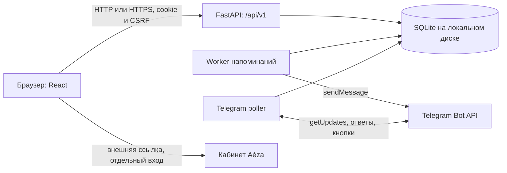

# Проект Aéza Услуги и продления

Руководство описывает поведение исходников проекта: веб-панель, собственное REST API, базу SQLite, напоминания и Telegram-меню. Оно подходит для знакомства с решением, демонстрации и передачи разработчику. Паролей, токенов и закрытых параметров стенда здесь нет. Текущую доступность сервера и результаты конкретного релиза проверяют отдельно; сведения о проведённых проверках находятся в [qa.md](qa.md).

## 1. Для чего нужен проект

Модуль помогает небольшой команде учитывать ежемесячные расходы на VPS, выделенные серверы, хранилище, хостинг, домены и другие инфраструктурные услуги. Администратор вводит название, сумму, валюту и ближайший срок. Приложение создаёт отдельные месячные периоды, показывает неоплаченные и просроченные продления, хранит отметки и фактические даты оплаты. Telegram напоминает о сроках и даёт просмотреть данные разрешённого чата.

Рабочая последовательность: команда узнаёт реальный срок в кабинете провайдера → вносит его в модуль → получает напоминание → оплачивает услугу у провайдера → вручную отмечает оплату и дату в модуле.

В заголовке основного экрана используется **«Услуги и продления»**, а в названии веб-приложения и профиле бота — **«Aéza · Контроль продлений»**. Это названия одного модуля. Технический каталог `invoice-keeper`, маршруты `/api/v1`, две роли и ежемесячные периоды сохранены из исходного задания. Текущий подготовленный профиль Telegram относится к `@aezainkeep_bot`; фактического бота определяет токен серверной конфигурации.

### Три разные системы, которые нельзя смешивать

| Система | Для чего используется | Кто к ней обращается |
|---|---|---|
| REST API этого проекта, `/api/v1/...` | Пользователи, периоды, ручные отметки, итоги, журнал | Веб-интерфейс, Swagger, авторизованный клиент разработчика |
| Telegram Bot API | Получить команды, отправить напоминание, отредактировать сообщение | Серверные `backend.worker` и `backend.telegram_bot`, служебный скрипт настройки профиля |
| Кабинет Aéza, `https://my.aeza.ru/` | Реальная оплата и управление услугами у провайдера | Пользователь по внешней ссылке, с отдельным входом |

**Интеграция с биллингом Aéza не реализована.** `integration_mode: "manual"` означает ручной учёт. Модуль не получает баланс, счета, тарифы, состояние VPS или подтверждения списаний; не покупает, не продлевает и не отключает услуги. Локальный логин не является логином кабинета провайдера и не даёт SSO. Кнопка «Кабинет Aéza» открывает внешний сайт.

### Что действительно работает

- Вход по логину и паролю, серверная сессия и выход с отзывом сессии.
- Общие для команды записи регулярных платежей и отдельные месячные периоды.
- Ручное подтверждение и отмена оплаты конкретного периода, исправление фактической даты.
- Просрочка по календарным дням, история, календарь, поиск и фильтры.
- Итоги отдельно по RUB, USD и EUR; экспорт показанного списка в CSV.
- Создание, изменение и удаление обычных пользователей администратором.
- Изменение названия, суммы и валюты серии со следующего месяца с сохранением истории.
- Прекращение учёта серии с сохранением уже созданных периодов.
- Устойчивый к перезапуску outbox напоминаний и отдельное Telegram-меню для просмотра.
- Административный журнал действий и просмотр состояний последних напоминаний.
- Русская Swagger-документация и OpenAPI.

### Ограничения текущей версии

Поддерживается только ежемесячная периодичность. Реальные годовые продления доменов, произвольные интервалы, частичная оплата, банковский процессинг, загрузка выписок, конвертация валют и автоматическая сверка с провайдером отсутствуют. Категории карточек «Сервер», «Хранилище», «Домен», «Хостинг» помогают начать ручное добавление; они не подключают услугу и не подставляют реальный тариф.

Все веб-пользователи видят общий набор финансовых записей; разграничения по проектам, владельцам или организациям нет. Нет самостоятельной регистрации, MFA, восстановления пароля по email и пользовательского управления серверными секретами. CSV формируется в браузере из текущего списка; отдельного API экспорта и импорта CSV нет. Проект рассчитан на один хост с локальной SQLite. Непрерывная доступность внешнего Telegram и абсолютная доставка «ровно один раз» не обещаются.

## 2. Как пользоваться веб-панелью

После входа доступны следующие разделы:

| Раздел | Что в нём делать |
|---|---|
| Обзор | Смотреть итоги выбранного месяца и валюты, ближайшие сроки, состояние ручных отметок |
| Продления | Найти нужный период, отфильтровать по статусу и валюте, отметить оплату, скачать CSV |
| Календарь | Смотреть сроки выбранного месяца по дням; на узком экране — списком |
| История оплат | Перейти к прошлым месяцам и проверить сроки, даты и просрочку |
| Пользователи | Администратору — создать, изменить или удалить обычного пользователя |
| Журнал | Администратору — просмотреть действия и состояния напоминаний |
| Настройки | Проверить часовой пояс, правила учёта и наличие параметров Telegram |

Создание продления доступно администратору. Обычный пользователь может отметить или отменить оплату, но не изменить сумму, валюту, название или график. Наличие кнопки не заменяет проверку прав: все административные операции отдельно защищены сервером.

Выбранный месяц относится к **сроку оплаты**, а не к месяцу фактического перевода. Например, период со сроком 31 января и оплатой 2 февраля остаётся в январском списке. Поиск и фильтры таблицы влияют на CSV: выгружаются показанные после фильтрации записи, а не вся база. CSV содержит название, сумму, валюту, срок, статус, фактическую дату и дни просрочки; храните выгрузку как финансовые данные.

В журнале интерфейс получает до 100 последних действий и 100 последних заданий напоминаний, фильтрует их локально и показывает действия порциями по 20. Счётчики этого раздела относятся только к полученной выборке. Это не глобальная статистика всех событий за всё время.

## 3. Архитектура и стек



В production перед FastAPI находится nginx: он принимает HTTPS и пересылает запросы на внутренний `127.0.0.1:8000`. API отдаёт и JSON, и готовую сборку `frontend/dist`, поэтому интерфейс и API используют один origin — сочетание схемы, хоста и порта. Неподдерживаемые `/api/...` возвращают `404`; клиентские маршруты интерфейса получают SPA.

| Компонент | Технологии и роль |
|---|---|
| Интерфейс | React 19, TypeScript, Vite, CSS, Lucide; отображение данных и формы |
| HTTP-сервер | FastAPI, Starlette, Uvicorn; авторизация, права, валидация, выдача сборки |
| Проверка входных данных | Pydantic; неизвестные поля запрещены |
| Данные | SQLite из стандартной библиотеки Python, WAL, внешние ключи, транзакции |
| Сеть Telegram | HTTPX; токен используется только серверными процессами |
| Конфигурация | Переменные окружения, локальный `python-dotenv`, `zoneinfo` и `tzdata` |
| Проверки | pytest, FastAPI TestClient, временные базы, HTTPX MockTransport |
| Доставка | Локальный PowerShell, Docker Compose либо Ubuntu/systemd + nginx |

Точные Python-версии пакетов закреплены в [requirements.txt](../requirements.txt), frontend — в [package.json](../frontend/package.json) и `package-lock.json`. Установка для новой среды ориентируется на Python 3.12+; Dockerfile использует Python 3.12 и Node.js 22. Готовый frontend не требует Node.js на сервере.

### Где искать реализацию

| Файл или каталог | Ответственность |
|---|---|
| `backend/app.py` | Маршруты, зависимости авторизации, CSRF, HTTP-заголовки, Swagger, SPA |
| `backend/models.py` | Допустимые тела запросов и проверки полей |
| `backend/domain.py` | Деньги, месяцы, генерация периодов, просрочка, постановка напоминаний |
| `backend/db.py` | Схема SQLite, соединение, `BEGIN IMMEDIATE`, администратор, аудит |
| `backend/security.py` | scrypt, HMAC сессий и CSRF |
| `backend/config.py` | Чтение и проверка серверных параметров |
| `backend/worker.py` | Захват задания outbox и отправка напоминания |
| `backend/telegram_bot.py` | Авторизованные команды, кнопки, long polling, offset и singleton lease |
| `backend/seed.py` | Идемпотентное наполнение пустой финансовой базы условными примерами |
| `frontend/src/api.ts` | Запросы браузера, cookie, CSRF и обработка ошибок |
| `frontend/src/App.tsx`, `forms.tsx`, `Payments.tsx`, `panels.tsx` | Навигация, формы и представления |
| `frontend/src/ActivityPanel.tsx` | Административный журнал и состояния напоминаний |
| `scripts/init_env.py`, `scripts/run.ps1` | Безопасная локальная инициализация и запуск |
| `scripts/deploy/` | systemd, nginx и серверные инструкции |

API, worker и poller — три отдельных процесса. API отвечает пользователю; worker сам проверяет сроки без открытого браузера; poller отвечает на команды и кнопки. У них общая конфигурация и одна SQLite. Остановка poller не отключает worker, остановка worker не запрещает веб-работу.

## 4. Данные и сущности

| Таблица | Что хранит | Важное свойство |
|---|---|---|
| `users` | Логин, отображаемое имя, хеш пароля, роль, признак `env_managed` | Логин уникален без учёта регистра; роли только `admin` и `user` |
| `sessions` | HMAC случайного токена, пользователя и срок действия | Открытого session token в базе нет |
| `login_attempts` | Хешированные ключи попыток и время | Ограничивает вход по паре IP/логин и по IP |
| `recurring_payments` | Текущие условия серии, исходную дату, число месяца, курсор генерации, активность | Это правило повторения, а не отдельная оплата |
| `payment_occurrences` | Снимок названия, суммы, валюты, срок, отметку и дату одного периода | Пара `(recurring_payment_id, due_date)` уникальна |
| `reminder_outbox` | Задание на период, состояние, попытки, lease и результат | `occurrence_id` уникален: одно задание на период |
| `audit_events` | Кто, какое действие, описание, UTC-время | Не содержит паролей и токенов; сохраняет текстовый логин автора |
| `telegram_pollers` | Хешированную область токена, offset, владельца lease, heartbeat | Один poller на токен в общей базе |
| `telegram_updates` | ID обновления, время, фиксированный результат | Не хранит текст команды или финансовый ответ |
| `telegram_rate_limits` | Окно и число обращений | Ограничивает ответы разрешённому чату |

Три `telegram_*` таблицы создаёт poller в своей `ensure_schema()`. Основная инициализация создаёт остальные таблицы и синхронизирует конфигурационного администратора. Включены внешние ключи, WAL и ожидание занятой базы до 15 секунд. Модифицирующие транзакции используют `BEGIN IMMEDIATE`: конкурирующие записи не проходят одновременно.

Снимок периода позволяет не переписывать прошлые суммы при изменении серии. При этом **ручные отметки и фактические даты исторического периода можно исправлять**. Сохранение истории означает сохранение самих периодов и прежних условий при изменении серии, а не запрет исправления ошибочной отметки пользователем.

У SQLite нет отдельного сетевого сервера. Нельзя размещать этот файл на сетевом диске и рассчитывать на распределённую блокировку. Для нескольких хостов потребовались бы другая база, координация фоновых задач и отдельная работа по миграции; в этой версии такого режима нет.

## 5. Месяцы, деньги и просрочка

### Правило месячного срока

У серии хранится исходное число месяца `anchor_day`. Следующий срок вычисляется по этому числу; если его нет в месяце, выбирается последний день. Поэтому 31 января → 28 февраля в невисокосный год → 31 марта. В високосный год промежуточный срок — 29 февраля. Ошибка «после февраля всегда 28-е» исключается сохранённым якорем.

Неоплаченный январь не блокирует февраль. Каждый период получает свой срок и статус. Срок не сдвигается на месяц от даты фактической оплаты и не меняется при исправлении этой даты.

Периоды материализуются, то есть создаются в SQLite из правил серий, при старте API, соответствующих чтениях API и проходах worker. Обычный горизонт — до конца следующего месяца включительно. Запрос конкретного будущего месяца может создать периоды до конца этого месяца. Telegram использует ту же логику. Это создание расчётных записей; оно не означает оплату или действие у провайдера.

Для первого срока и фильтра месяца разрешён диапазон от 2000 года до текущего года плюс пять лет. Срок передаётся `YYYY-MM-DD`, месяц — `YYYY-MM`. Годовые циклы не поддерживаются: «Домены · ежемесячный учёт» в seed — условный месячный расход для демонстрации.

### Деловая дата и техническое время

`TIMEZONE`, по умолчанию `Europe/Moscow`, задаёт единое «сегодня» для сроков, просрочки, напоминаний и границы следующего месяца. Смена часового пояса не переносит введённый календарный срок на другой день. Техническое время журнала и отправок записывается в UTC; интерфейс показывает его в настроенном поясе.

### Деньги

На сервере сумма переводится в целые минимальные единицы: `"1490.25"` → `149025`. Арифметика итогов выполняется над целыми числами. Допустима положительная сумма от `0.01` до `999999999.99`, максимум два десятичных знака. API рекомендует передавать сумму строкой с точкой; ответ также содержит строку с двумя знаками. Локализованная запись `"1 490,25"` не является форматом JSON API.

Поддерживаются только `RUB`, `USD`, `EUR`. План, оплачено, не оплачено и просрочено считаются отдельно для каждой валюты. Ни курс, ни суммарный «рублёвый эквивалент» не вычисляются.

### Статус и количество дней

| Ситуация | `status` | `overdue_days` |
|---|---|---|
| Не оплачено, срок сегодня или позже | `pending` | `0` |
| Не оплачено, срок раньше сегодня | `overdue` | Сегодня минус срок |
| Оплата отмечена | `paid` | Максимум из нуля и разницы фактической даты со сроком |

Для совместимости ответ также содержит `late_days` с тем же значением. У оплаченного с опозданием периода статус остаётся `paid`, а число дней может быть положительным. В сумму `overdue` итогов входят только **пока неоплаченные** просроченные периоды; поздняя уже отмеченная оплата учитывается в `paid`.

При первом подтверждении без даты сервер ставит сегодня; при повторном подтверждении без новой даты сохраняет уже записанную дату. Явно переданная дата исправляет её; дата позже сегодня запрещена. Отмена оплаты очищает `paid_at` и снова считает неоплаченный период от сегодняшней даты.

### Изменение серии со следующего месяца

Администратор меняет ровно три поля: `name`, `amount`, `currency`. `effective_from` — первое число следующего месяца в `TIMEZONE`. Если редактировать 24 октября, новые условия начинаются 1 ноября:

- Условия серии и уже созданные **неоплаченные** периоды со сроком от 1 ноября получают новые значения.
- Октябрь, прошлые периоды и оплаченные будущие периоды сохраняют прежнее название, сумму и валюту.
- Ещё не созданные будущие периоды используют новые условия серии.
- Исходный якорь, сроки, идентификаторы, курсор генерации и состояния доставки не сбрасываются.
- Одинаковые после нормализации условия не создают новое событие аудита.

Прекращённая серия даёт `409`. Если пропущенные текущие/прошлые периоды ещё не созданы, сервер тоже даёт `409`: сначала обновите список через GET, затем повторите PATCH. Если worker уже отправляет напоминание затрагиваемого будущего неоплаченного периода, изменения отклоняются атомарно с `409`.

Прекращение учёта через DELETE устанавливает `active=false`. Новые периоды не генерируются, напоминания прекращаются; все уже созданные, включая будущие, сохраняются. Это действие не удаляет VPS или домен у провайдера. Восстановления серии отдельной кнопкой или API нет.

## 6. Как работают напоминания

Worker выбирает активные неоплаченные периоды со сроком не позже «сегодня плюс три дня». Нижней границы нет: добавленный поздно или уже просроченный период тоже может получить напоминание. При пустой очереди проверка повторяется примерно каждые 15 секунд; при наличии заданий worker обрабатывает их последовательно без обязательной 15-секундной паузы между сообщениями.

Это одно напоминание на период, а не ежедневная рассылка до оплаты. Уникальность outbox защищает от повторной постановки. В транзакции worker захватывает задание на 60 секунд и перед внешней отправкой ещё раз проверяет неоплаченность и активность серии. Несколько worker могут координироваться только через ту же SQLite на одном хосте.

| Состояние outbox | Значение |
|---|---|
| `pending` | Поставлено в очередь |
| `sending` | Захвачено конкретным worker для отправки |
| `retry` | Известная ошибка до отправки либо явный отказ Telegram; повтор после паузы |
| `sent` | Telegram подтвердил успех и вернул корректный `message_id` |
| `cancelled` | Отправка подавлена после отметки оплаты или прекращения учёта |
| `unknown` | Результат неоднозначен; требуется проверить чат, автоматический повтор отключён |

`attempts` — число захватов задания для попытки, а не число прочитанных пользователем сообщений. `sent` подтверждает ответ API Telegram, а не прочтение адресатом. `next_attempt_at` — Unix-время следующей допустимой попытки; `sent_at` — UTC-время подтверждённой отправки.

Один HTTP-клиент worker переиспользуется в течение процесса. Есть один повтор **только установления соединения до отправки**; таймауты connect/write/read/pool заданы отдельно. Ошибки чтения и записи не воспроизводят запрос автоматически. Read/write timeout, некорректный ответ и истёкший lease после сбоя переводят задание в `unknown`. Telegram `sendMessage` не имеет используемого здесь ключа идемпотентности: ответ мог потеряться после принятия сообщения. Поэтому абсолютная гарантия exactly-once недостижима.

Оплата отменяет ожидающие `pending`/`retry`; отмена отметки активного периода может возобновить ранее отменённое задание. Уже `sent` и `unknown` не сбрасываются ради повторной рассылки. Смена будущих условий также не сбрасывает outbox. При гонке оплату нельзя использовать, чтобы отозвать сообщение, уже переданное Telegram.

Администратор проверяет состояния в «Журнал → Напоминания» или `GET /api/v1/reminders` и сверяет `unknown` с чатом. В интерфейсе и REST API нет кнопки принудительного повтора или массового сброса очереди. Ручное обслуживание базы — отдельное решение оператора после резервной копии и остановки процессов.

Без обоих параметров `TELEGRAM_BOT_TOKEN` и `TELEGRAM_CHAT_ID` worker не выполняет сетевые отправки. Задания могут сохраняться, чтобы быть обработанными после подключения; включение Telegram при наличии старых неоплаченных записей способно начать их отправку. Признак `telegram_configured=true` сообщает только о наличии параметров, а не об успешной доставке.

## 7. Telegram-меню

| Команда | Результат |
|---|---|
| `/start` | 🗂 Открыть меню |
| `/menu` | 🏠 Показать меню |
| `/summary` | 📊 Итоги текущего месяца отдельно по валютам |
| `/payments` | 🧾 Продления текущего месяца |
| `/upcoming` | 📅 Неоплаченные сроки от сегодня до даты через семь дней включительно |
| `/overdue` | ⚠️ Все неоплаченные периоды со сроком раньше сегодня |
| `/help` | ℹ️ Справка, правила учёта и доступа |

Список содержит до шести записей на страницу. В сводке и месячном списке можно выбирать месяц; «Обновить» запрашивает свежие данные. Callback редактирует исходное сообщение через `editMessageText`, а не посылает новое при каждом нажатии. Разделы и страницы имеют ограниченный формат callback; произвольных команд изменения данных в нём нет.

«🗂 Модуль продлений» открывает настроенную веб-панель только при допустимом публичном HTTPS-origin. В локальном HTTP-режиме этой URL-кнопки нет. «🔗 Кабинет Aéza» открывает `https://my.aeza.ru/` с отдельным входом.

Доступ разрешён только при точном совпадении фактического `chat.id` с `TELEGRAM_CHAT_ID`. Для личного callback дополнительно проверяется `from.id`; inline callback без исходного чата запрещён. Чужие чаты игнорируются без финансового ответа. Если оператор разрешил группу, просмотр доступен её участникам: роли веб-пользователей внутри Telegram не проверяются. Бот не меняет отметки оплаты, суммы, пользователей или состояние услуг.

Poller использует `getUpdates` с ожиданием до 20 секунд. SQLite lease на 90 секунд и heartbeat каждые 10 секунд допускают один обработчик токена в общей базе. Offset фиксируется **до** отправки ответа, включая подтверждение callback. Если процесс остановился между фиксацией и ответом, ответ может пропасть и не будет автоматически повторён. Пользователь может отправить команду ещё раз — это новое обновление.

Короткий журнал обработанных обновлений ограничен семью днями и последними 1000 записями на область токена; offset сохраняется независимо от очистки. Ответы ограничены восемью обращениями за десять секунд. Установленный webhook poller не удаляет. Другой poller или ручной `getUpdates` с тем же токеном и отдельной базой не координируется этой блокировкой.

Тексты и аватар лежат в `assets/telegram/`. Изменение этих файлов само по себе ничего не публикует. `scripts/configure_telegram.py` — отдельная операция настройки профиля: он проверяет ожидаемого бота и чат, задаёт профиль и перечитывает результат. В публичной области команд заданы `/start` и `/help`, полный список — для подключённого чата; безопасность обеспечивает runtime-проверка chat ID. Подробности подключения — в [telegram.md](telegram.md).

## 8. Роли и безопасность

| Действие | Обычный пользователь | Администратор |
|---|---|---|
| Просматривать общие периоды, календарь, итоги, настройки и Swagger | Да | Да |
| Отметить/отменить оплату периода, исправить дату | Да | Да |
| Создать серию, изменить будущие условия, прекратить учёт | Нет | Да |
| Управлять обычными пользователями | Нет | Да |
| Просматривать административный журнал и outbox | Нет | Да |
| Создать второго администратора или изменить конфигурационного через API | Нет | Нет |

Администратор берётся из `ADMIN_USERNAME` и `ADMIN_PASSWORD_HASH`. При запуске окружение синхронизируется с записью `env_managed`; изменение логина или хеша отзывает его прежние сессии. Управление обычными пользователями не принимает `role` и не позволяет повысить права. Любое изменение обычного пользователя, включая имя, отзывает все его сессии; удаление также завершает доступ. Платежные периоды при удалении пользователя сохраняются.

Пароли хешируются с солью через scrypt (`N=16384, r=8, p=5`, производный ключ 64 байта). Браузер получает случайный токен в cookie `ik_session`; сервер хранит только HMAC токена, срок жизни по умолчанию — 12 часов. Cookie имеет `HttpOnly`, `SameSite=Strict`, а при HTTPS — `Secure`. API возвращает отдельный `csrf_token`; это не пароль и не Telegram-токен, но его тоже не нужно публиковать.

Для POST/PATCH/DELETE после входа обязательна действующая сессия и заголовок `X-CSRF-Token`. Если заголовок `Origin` присутствует, он должен точно совпадать с `APP_ORIGIN` или дополнительным разрешённым origin; cross-site браузерные запросы отклоняются. У CLI может не быть Origin, но это не отменяет сессию и CSRF. Примеры ниже передают Origin явно. CORS с произвольными сайтами не включён.

Попытки входа ограничены по IP/логину и по IP за десять минут; проверка выполняется до затратного сравнения пароля. Успешный вход очищает лимит пары IP/логин, общий IP-лимит сохраняется. Ошибка не раскрывает, существует ли логин. Вход и выход записываются в аудит.

Неизвестные JSON-поля отклоняются; строки и суммы проверяются сервером. Максимальное тело изменяющего запроса — 64 КБ, непустое тело должно иметь `Content-Type: application/json`. SQL использует параметры. React экранирует пользовательский текст, HTML Telegram формируется с экранированием имён. Выгрузка CSV обрабатывает опасные начала ячеек. HTTP-заголовки ограничивают встраивание, типы контента и внешние источники; HSTS включается при защищённом cookie. Swagger-ресурсы поставляются локально.

Страница входа и статические файлы интерфейса публичны; финансовые данные, Swagger и OpenAPI требуют входа. `health` публичен и возвращает только `{"status":"ok"}`. Статические JS/CSS Swagger не являются закрытыми данными. Пароли, токены, `.env` и база не раздаются через файловый маршрут приложения. При этом оператор обязан отдельно защищать диск, резервные копии и доступ к серверу: API не шифрует содержимое SQLite на диске.

Секреты нельзя помещать в `VITE_*`, frontend-код, Git, публичный ZIP, URL команд или сообщения об ошибках. Полный URL Telegram содержит bot token; его нельзя журналировать. Ограничения и серверные меры подробно описаны в [security.md](security.md).

## 9. REST API: объяснение без опыта

API — способ выполнить те же действия программно. Клиент отправляет HTTP-запрос на адрес сервера; сервер проверяет вход, права и данные, затем возвращает JSON или ответ без тела. Swagger показывает эти маршруты в браузере и позволяет проверить запрос после входа в панель.

- `GET` получает данные. В этом проекте чтение финансовых списков также может создать недостающие расчётные периоды.
- `POST` выполняет вход или создаёт запись; выход тоже оформлен POST.
- `PATCH` меняет переданные поля. Для изменения серии, в отличие от пользователя, нужны все три обязательных поля.
- `DELETE` прекращает учёт серии либо удаляет обычного пользователя — действие зависит от маршрута.

`id` — числовой идентификатор записи. ID серии и ID периода — разные значения. Для отметки оплаты требуется ID **периода**, а не серии. Query-параметры после `?` фильтруют GET, например `?month=2026-10&currency=RUB`.

Сначала войдите в веб-панель, затем откройте `/api/v1/docs` на том же адресе. Выполните `GET /api/v1/auth/me`, скопируйте `csrf_token` в «Авторизация → csrfHeader». Cookie браузер отправляет сам: значение session cookie вручную вводить не требуется. Документация `/api/v1/openapi.json` защищена тем же входом; файл `openapi.json` в поставке — статическая копия спецификации конкретного релиза.

### Полный перечень прикладных маршрутов

Все адреса в таблице включают префикс `/api/v1`. «Вход» означает любую из двух веб-ролей; «CSRF» требуется для изменяющих запросов после авторизации.

| Метод и маршрут | Доступ | Данные и результат |
|---|---|---|
| `GET /api/v1/health` | Публичный | `{"status":"ok"}`; не проверяет доставку Telegram |
| `POST /api/v1/auth/login` | Публичный, лимит попыток | `{username,password}` → `{user,csrf_token}` и cookie |
| `GET /api/v1/auth/me` | Вход | Текущий `{user,csrf_token}` |
| `POST /api/v1/auth/logout` | Вход + CSRF | Отзыв текущей сессии, `204` |
| `GET /api/v1/recurring-payments` | Вход | Массив серий; `include_inactive=false` по умолчанию |
| `POST /api/v1/recurring-payments` | Администратор + CSRF | Новая серия, `201` |
| `PATCH /api/v1/recurring-payments/{payment_id}` | Администратор + CSRF | Новые `name,amount,currency`, ответ серии с `effective_from` |
| `DELETE /api/v1/recurring-payments/{payment_id}` | Администратор + CSRF | Прекратить учёт, `204` |
| `GET /api/v1/payment-occurrences` | Вход | Массив периодов; фильтры ниже |
| `GET /api/v1/payment-occurrences/{occurrence_id}` | Вход | Один период или `404` |
| `PATCH /api/v1/payment-occurrences/{occurrence_id}` | Вход + CSRF | `is_paid` и/или `paid_at`; ответ обновлённого периода |
| `GET /api/v1/payments/summary` | Вход | Итоги, необязательный `month` |
| `GET /api/v1/users` | Администратор | Массив пользователей, включая `env_managed` |
| `POST /api/v1/users` | Администратор + CSRF | `{username,full_name,password}` → обычный пользователь, `201` |
| `PATCH /api/v1/users/{user_id}` | Администратор + CSRF | Непустой набор `username`, `full_name`, `password`; сессии пользователя отзываются |
| `DELETE /api/v1/users/{user_id}` | Администратор + CSRF | Удаление обычного пользователя, `204` |
| `GET /api/v1/settings` | Вход | `timezone,today,telegram_configured,reminder_days,product_name,integration_mode` |
| `GET /api/v1/activity` | Администратор | `limit` от 1 до 100, по умолчанию 30; последние события |
| `GET /api/v1/reminders` | Администратор | Последние 100 заданий outbox с состояниями и фиксированными ошибками |

Документационные маршруты: `GET /api/v1/docs` и `GET /api/v1/openapi.json` требуют входа. `GET /api/v1/docs-assets/{filename}` отдаёт только разрешённые локальные JS/CSS документации. Отдельного `GET /api/v1/recurring-payments/{id}`, REST-маршрута Telegram-токена, API оплаты провайдеру или регистрации пользователя нет.

### Поля и фильтры для разработчика

Создание серии:

```json
{
  "name": "VPS · учебный пример",
  "amount": "1490.00",
  "currency": "RUB",
  "next_due_date": "2026-10-24",
  "frequency": "monthly"
}
```

Дата выше — только пример формата; в реальном запросе выбирайте нужную допустимую дату. `frequency` можно опустить, его единственное допустимое значение — `monthly`. Название — от 1 до 160 символов. Ответ серии: `id,name,amount,currency,next_due_date,anchor_day,frequency,active`; после изменения условий добавляется `effective_from`.

`next_due_date` ответа серии — ближайший уже созданный срок не раньше сегодня, а при его отсутствии — курсор генерации. Это не обязательно ближайшая неоплаченная задолженность. Для задолженности используйте периоды с `status=unpaid` или `overdue`.

Фильтры `GET /payment-occurrences`:

| Параметр | Значения |
|---|---|
| `month` | `YYYY-MM`; без него возвращаются все созданные периоды, включая будущие и архивные |
| `currency` | `RUB`, `USD`, `EUR` |
| `status` | `paid`, `unpaid`, `overdue`, `pending`, `all`; `unpaid` включает pending и overdue |
| `search` | Подстрока названия, до 160 символов |

Без параметра `month` итоги также относятся ко всем созданным периодам. API списка периодов не имеет серверной пагинации; это следует учитывать при росте истории. Поиск API использует штатный SQLite `lower`/`instr`: не обещает полноценный Unicode-поиск без учёта регистра. Поиск в браузерной таблице отдельно использует русскую локализацию.

Пример формы одного периода, значения условные:

```json
{
  "id": 17,
  "recurring_payment_id": 4,
  "name": "VPS · учебный пример",
  "amount": "1490.00",
  "currency": "RUB",
  "due_date": "2026-10-20",
  "is_paid": true,
  "paid_at": "2026-10-22",
  "status": "paid",
  "overdue_days": 2,
  "late_days": 2,
  "recurring_active": true
}
```

Итоги возвращают `currencies` с ключами `RUB`, `USD`, `EUR`; в каждом — строковые `planned`, `paid`, `unpaid`, `overdue`. Рядом находятся количества `total_count`, `paid_count`, `unpaid_count`, `overdue_count`. Даже при пустом месяце все три валюты присутствуют с нулями.

Пользователь в ответах: `id,username,full_name,role`. Хеш и пароль не возвращаются. При создании логин содержит 3–64 латинских символа, цифры или `_.@-`, имя — 1–100 символов, пароль — 12–256. PATCH пользователя требует хотя бы одно непустое поле; `null` для переданного поля не принимается. Поле `role` в этих запросах запрещено.

Напоминание из диагностического API содержит `id,occurrence_id,state,attempts,next_attempt_at,sent_at,last_error,name,due_date`. Событие журнала содержит `id,username,action,description,created_at`. Ни один из этих ответов не должен использоваться как подтверждение реального списания у провайдера.

### Основные HTTP-коды

| Код | Что проверить |
|---|---|
| `200` | Успешный JSON-ответ |
| `201` | Запись создана |
| `204` | Успех без тела; не пытайтесь обязательно разобрать JSON |
| `401` | Нет сессии, неверный пароль либо сессия истекла/отозвана |
| `403` | Роль, CSRF, Origin или cross-site запрос |
| `404` | Записи или маршрута нет |
| `409` | Занятый логин, прекращённая серия, устаревшая генерация или отправляемое будущее напоминание |
| `413` | Тело больше 64 КБ |
| `415` | Непустое тело имеет неподходящий Content-Type |
| `422` | Неверные поля, сумма, дата, валюта или неизвестный JSON-ключ |
| `429` | Ограничение попыток входа; учитывайте `Retry-After` |

Ошибки имеют `detail`: строку либо массив сведений о полях (`loc,msg,type`). Валидатор не возвращает исходный пароль или всё тело запроса. Не обрабатывайте ошибку как успешный финансовый результат.

## 10. Безопасные примеры PowerShell для API

Примеры выполняются из PowerShell на вашем экземпляре. Они не требуют Telegram-токена и не вызывают API провайдера. Не вставляйте пароль в исходник или аргументы команд. `Get-Credential` вводит его скрыто; для отправки JSON он кратковременно преобразуется в строку в памяти клиента. Не печатайте JSON входа, cookie, CSRF и не записывайте их в transcript. Для удалённого сервера используйте HTTPS с обычной проверкой сертификата; не добавляйте `-SkipCertificateCheck`.

### Вход, cookie и CSRF

```powershell
$Origin = 'http://127.0.0.1:8000' # Для сервера замените на его точный HTTPS-origin без пути.
$ApiRoot = "$Origin/api/v1"
$Credentials = Get-Credential -Message 'Учётная запись модуля продлений'
$LoginJson = @{
    username = $Credentials.UserName
    password = $Credentials.GetNetworkCredential().Password
} | ConvertTo-Json -Compress

try {
    $Authentication = Invoke-RestMethod -Method Post -Uri "$ApiRoot/auth/login" `
        -ContentType 'application/json' `
        -Body ([System.Text.Encoding]::UTF8.GetBytes($LoginJson)) `
        -Headers @{ Origin = $Origin } -SessionVariable ApiSession
}
finally {
    $LoginJson = $null
    $Credentials = $null
}

$Csrf = $Authentication.csrf_token
$WriteHeaders = @{ Origin = $Origin; 'X-CSRF-Token' = $Csrf }
$Authentication.user | Format-List id, username, full_name, role
```

`-SessionVariable ApiSession` сохраняет полученный cookie в объект WebSession. Следующие запросы должны использовать **тот же** `-WebSession $ApiSession`. Здесь выводятся только публичные поля пользователя. `APP_ORIGIN`, заголовок Origin и адрес запросов должны совпадать: `localhost` и `127.0.0.1`, а также разные порты — разные origin.

### Чтение текущего месяца

```powershell
$AppSettings = Invoke-RestMethod -Uri "$ApiRoot/settings" -WebSession $ApiSession
$Month = $AppSettings.today.Substring(0, 7)
$Periods = @(Invoke-RestMethod -Uri "$ApiRoot/payment-occurrences?month=$Month" `
    -WebSession $ApiSession)
$Periods | Select-Object id, name, amount, currency, due_date, is_paid, paid_at

$Totals = Invoke-RestMethod -Uri "$ApiRoot/payments/summary?month=$Month" `
    -WebSession $ApiSession
$Totals.currencies.RUB
```

Если нужно заново получить CSRF в этой сессии:

```powershell
$Me = Invoke-RestMethod -Uri "$ApiRoot/auth/me" -WebSession $ApiSession
$Csrf = $Me.csrf_token
$WriteHeaders = @{ Origin = $Origin; 'X-CSRF-Token' = $Csrf }
```

### Изменяющий пример: создать учебную серию

Следующие запросы **меняют локальную базу**. Выполняйте их на своей демонстрационной среде и под администратором. Они не покупают сервер и не списывают деньги. При включённом worker и подключённом Telegram учебная запись со сроком сегодня может вызвать настоящее напоминание в разрешённый чат; для чистой API-демонстрации запустите среду без worker и bot.

```powershell
$CreateJson = @{
    name = 'VPS · учебный пример'
    amount = '1490.00'
    currency = 'RUB'
    next_due_date = $AppSettings.today
    frequency = 'monthly'
} | ConvertTo-Json -Compress

$Created = Invoke-RestMethod -Method Post -Uri "$ApiRoot/recurring-payments" `
    -WebSession $ApiSession -Headers $WriteHeaders -ContentType 'application/json' `
    -Body ([System.Text.Encoding]::UTF8.GetBytes($CreateJson))
$SeriesId = $Created.id

$CreatedPeriods = @(Invoke-RestMethod -Uri "$ApiRoot/payment-occurrences?month=$Month" `
    -WebSession $ApiSession)
$ExamplePeriod = $CreatedPeriods | Where-Object {
    $_.recurring_payment_id -eq $SeriesId -and $_.due_date -eq $AppSettings.today
} | Select-Object -First 1
if ($null -eq $ExamplePeriod) { throw 'Учебный период не найден; запрос изменения не выполнен.' }
$PeriodId = $ExamplePeriod.id
```

### Отметить и отменить оплату только учебного периода

Обе роли могут выполнять этот PATCH. В примере ID получен из созданной выше серии, а не выбран из чужих финансовых записей.

```powershell
$PaidJson = @{ is_paid = $true; paid_at = $AppSettings.today } | ConvertTo-Json -Compress
$UpdatedPeriod = Invoke-RestMethod -Method Patch -Uri "$ApiRoot/payment-occurrences/$PeriodId" `
    -WebSession $ApiSession -Headers $WriteHeaders -ContentType 'application/json' `
    -Body ([System.Text.Encoding]::UTF8.GetBytes($PaidJson))
$UpdatedPeriod | Select-Object id, is_paid, paid_at, overdue_days

# Отдельное действие: отмена отметки очищает дату.
$UnpaidJson = @{ is_paid = $false } | ConvertTo-Json -Compress
$UpdatedPeriod = Invoke-RestMethod -Method Patch -Uri "$ApiRoot/payment-occurrences/$PeriodId" `
    -WebSession $ApiSession -Headers $WriteHeaders -ContentType 'application/json' `
    -Body ([System.Text.Encoding]::UTF8.GetBytes($UnpaidJson))
```

### Изменить будущие условия и прекратить учебный учёт

```powershell
$FutureJson = @{
    name = 'VPS · учебный пример'
    amount = '1590.00'
    currency = 'RUB'
} | ConvertTo-Json -Compress
$Future = Invoke-RestMethod -Method Patch -Uri "$ApiRoot/recurring-payments/$SeriesId" `
    -WebSession $ApiSession -Headers $WriteHeaders -ContentType 'application/json' `
    -Body ([System.Text.Encoding]::UTF8.GetBytes($FutureJson))
$Future | Select-Object id, name, amount, currency, effective_from

# Отдельное действие: история остаётся, дальнейший учёт прекращается.
Invoke-RestMethod -Method Delete -Uri "$ApiRoot/recurring-payments/$SeriesId" `
    -WebSession $ApiSession -Headers $WriteHeaders | Out-Null
```

Если PATCH вернул `409` с просьбой обновить список, выполните `GET /recurring-payments` или месячный GET периодов и повторите изменение. Не заменяйте это прямым редактированием курсора в SQLite.

### Посмотреть административную диагностику и выйти

```powershell
$Activity = Invoke-RestMethod -Uri "$ApiRoot/activity?limit=20" -WebSession $ApiSession
$Activity | Select-Object created_at, username, action, description

$Reminders = Invoke-RestMethod -Uri "$ApiRoot/reminders" -WebSession $ApiSession
$Reminders | Select-Object id, name, due_date, state, attempts, sent_at

Invoke-RestMethod -Method Post -Uri "$ApiRoot/auth/logout" -WebSession $ApiSession `
    -Headers $WriteHeaders | Out-Null
$ApiSession = $null
$Authentication = $null
$Me = $null
$Csrf = $null
$WriteHeaders = $null
```

`activity` и `reminders` обычному пользователю вернут `403`; это ожидаемая проверка прав. Выход отзывает сессию на сервере. Обнуление переменных сокращает случайный доступ к ним в продолжении сеанса PowerShell, но не является гарантией криптографического стирания памяти.

## 11. Локальный запуск

Работайте из корня проекта `invoice-keeper`. Требуется Python 3.12+; Node.js 22 с npm нужен, если вы собираете или меняете frontend. Если в поставке есть готовый `frontend/dist`, повторная сборка для обычного запуска не требуется.

### Windows / PowerShell

```powershell
python -m venv .venv
.\.venv\Scripts\python.exe -m pip install -r requirements.txt
.\.venv\Scripts\python.exe scripts/init_env.py
```

Инициализатор попросит пароль администратора со скрытым вводом и подтверждением; затем предложит отдельный пароль `demo`, который можно пропустить. По умолчанию логин — `admin`; для другого есть `--admin-username`. Для исключения демопароля используйте `--no-demo`. Пароли должны иметь 12–256 символов. Инициализатор локального env-файла не принимает одинарную кавычку, обратный слеш и перенос строки; это ограничение записи env, а не механизм восстановления пароля.

Скрипт создаёт `.env` с scrypt-хешем администратора и случайным `APP_SECRET`. Открытый пароль администратора в файл не записывается. Не заменяйте хеш обычным паролем. Существующий `.env` не перезаписывается: повторная инициализация завершится ошибкой, сохранив файл. Если задан демопароль, `DEMO_USER_PASSWORD` остаётся локальным секретом seed; не публикуйте весь env-файл.

При необходимости собрать интерфейс:

```powershell
Set-Location frontend
npm ci
npm run build
Set-Location ..
```

Для новой учебной базы можно явно выполнить:

```powershell
.\.venv\Scripts\python.exe -m backend.seed
```

Seed добавляет шесть серий инфраструктурных расходов с условными RUB/USD/EUR, прошлыми отмеченными периодами, неоплаченными сроками и просрочкой. Это не тарифы Aéza. Если финансовые серии уже существуют, они не переименовываются и не заменяются. Пользователь `demo` создаётся только при явно заданном `DEMO_USER_PASSWORD`; пароля по умолчанию нет. Seed не отправляет Telegram-сообщения, но ставит задания для последующего worker.

Первый запуск без фоновых процессов удобно выполнить так:

```powershell
.\scripts\run.ps1 -NoWorker -NoBot
```

Откройте `http://127.0.0.1:8000`, войдите своим администратором. Полный запуск после настройки Telegram:

```powershell
.\scripts\run.ps1
```

Runner запускает API и выбранные фоновые процессы; `Ctrl+C` инициирует остановку. Worker и bot получают общий уникальный stop-file, завершают текущий запрос и имеют до 45 секунд на выход. Если мягкая остановка не завершилась, runner выдаёт предупреждение о принудительной. `-NoWorker` и `-NoBot` отключают процессы независимо; другой порт требует соответствующего `APP_ORIGIN`.

Если локальный PowerShell не разрешает выполнение скрипта, можно открыть отдельные терминалы без изменения общей политики:

```powershell
# Первый терминал, из корня проекта.
.\.venv\Scripts\python.exe -m uvicorn backend.app:app --host 127.0.0.1 --port 8000 --no-access-log --no-proxy-headers
```

```powershell
# Второй терминал, только если нужны настоящие напоминания.
.\.venv\Scripts\python.exe -m backend.worker
```

```powershell
# Третий терминал, только если нужны команды Telegram.
.\.venv\Scripts\python.exe -m backend.telegram_bot
```

Фоновые логи runner находятся в локальном `data/`. Без параметров Telegram API работает, worker сохраняет задания без отправки, а poller сообщает об отсутствии конфигурации и завершает работу. Не запускайте второй poller того же токена параллельно на другом компьютере.

### Параметры окружения

| Переменная | Смысл |
|---|---|
| `ADMIN_USERNAME` | Логин конфигурационного администратора |
| `ADMIN_PASSWORD_HASH` | Scrypt-хеш установленного формата; не открытый пароль |
| `APP_SECRET` | Случайный серверный секрет от 32 символов; участвует в HMAC сессий и CSRF |
| `APP_ORIGIN` | Точный origin без пути, локально `http://127.0.0.1:8000` |
| `APP_ALLOWED_ORIGINS` | Дополнительные точные браузерные origin через запятую; обычно пусто |
| `TIMEZONE` | Деловой часовой пояс, по умолчанию `Europe/Moscow` |
| `DATABASE_PATH` | Постоянный путь SQLite; относительный считается от корня проекта |
| `COOKIE_SECURE` | `false` для локального HTTP, `true` для HTTPS |
| `SESSION_HOURS` | От 1 до 168 часов, по умолчанию 12 |
| `TELEGRAM_BOT_TOKEN` | Секрет Bot API только на сервере |
| `TELEGRAM_CHAT_ID` | Единственный разрешённый числовой чат |
| `DEMO_USER_PASSWORD` | Необязательный секрет, используется только seed для создания `demo` |

Обычное окружение процесса имеет приоритет над локальным `.env`. Приложение не запускается с пустыми обязательными секретами или неподходящим хешем; для HTTPS требует `COOKIE_SECURE=true`. Смена `APP_SECRET` делает ранее выданные сессии непригодными. После изменения конфигурации перезапустите все использующие её процессы.

### Linux/macOS и Docker

Linux/macOS используют `.venv/bin/python` вместо Windows-пути. Создайте окружение `python3 -m venv .venv`, установите зависимости, выполните инициализацию и при необходимости сборку. Команды модулей остаются теми же.

Альтернатива — [compose.yaml](../compose.yaml): один образ для `api`, `worker`, `bot`, постоянный том `invoice-data`, публикация API на `127.0.0.1:8000`. Сначала локально создайте секретный `.env`; Node.js на хосте для сборки Docker-образа не нужен.

```powershell
docker compose build
# Только для новой демонстрационной базы:
docker compose run --rm api python -m backend.seed
docker compose up -d
docker compose logs -f api worker bot
```

`docker compose down` сохраняет том. `down -v` удаляет данные и не подходит для обычной остановки. Сборка образа исключает локальные секреты и данные; внутри процессы работают от непривилегированного пользователя.

## 12. Сервер и сопровождение

Нативные Ubuntu-шаблоны находятся в [scripts/deploy/README.md](../scripts/deploy/README.md). Они описывают один хост с локальным диском:

| Размещение | Назначение |
|---|---|
| `/opt/aeza-renewals/current` | Root-владелец, исходники, `.venv`, готовый frontend; сервисам только чтение/исполнение |
| `/etc/aeza-renewals/environment` | Закрытый root-owned `EnvironmentFile`, права `0600` |
| `/var/lib/aeza-renewals` | Постоянная SQLite/WAL; доступ пользователя сервиса, каталог `0700` |
| `aeza-renewals-api.service` | Uvicorn на внутреннем `127.0.0.1:8000` |
| `aeza-renewals-worker.service` | Напоминания |
| `aeza-renewals-bot.service` | Команды и кнопки |

В systemd-развёртывании не оставляйте локальный `.env` в релизе: параметры передаются через EnvironmentFile; существующий недоступный `.env` способен помешать загрузке. Windows `.venv` на Ubuntu не переносится, зависимости устанавливаются на целевой системе.

Nginx завершает TLS и перезаписывает `X-Forwarded-For` реальным адресом клиента, `X-Forwarded-Proto` — фактической HTTPS-схемой. Uvicorn доверяет forwarded-заголовкам только loopback proxy. Не открывайте внутренний порт напрямую и не разрешайте доверие любому внешнему адресу: IP влияет на лимит входа. Файл nginx в поставке относится к конкретному стенду; при другом адресе оператор меняет origin, `server_name`, redirect и сертификат согласованно.

Сервисы работают от `aeza-renewals` с `NoNewPrivileges`, `ProtectSystem=strict`, `ProtectHome`, приватным `/tmp`, пустыми capabilities и записью только в каталог состояния. `Restart=on-failure` имеет паузу и ограничение частоты, а не бесконечный цикл без задержек. Штатная остановка — `SIGTERM`, предел 45 секунд. Worker заканчивает текущую сетевую попытку; polling-бот проверяет остановку после запроса и в паузах. Таймауты сетевых фаз не являются строгим общим deadline; при принудительной остановке неоднозначные доставки требуют проверки.

Команды оператора для уже установленной среды:

```bash
sudo systemctl status aeza-renewals-api.service aeza-renewals-worker.service aeza-renewals-bot.service
sudo journalctl -u aeza-renewals-worker.service -n 50 --no-pager
sudo journalctl -u aeza-renewals-bot.service -n 50 --no-pager
```

После обновления кода или закрытого окружения оператор выполняет согласованный перезапуск:

```bash
sudo systemctl restart aeza-renewals-api.service aeza-renewals-worker.service aeza-renewals-bot.service
```

Статус systemd `active` означает живой процесс, а не успешный вход или доставку. `/api/v1/health` проверяет HTTP-доступность и не заменяет проверку пользовательского сценария и outbox. Сертификат, свободное место, сеть к Telegram и срок аренды тестового хоста обслуживаются отдельно; исходники не гарантируют их текущего состояния.

### Резервное копирование и перенос

Остановите все три процесса перед обычным переносом базы либо используйте согласованный SQLite backup API. При работающем WAL копирования только `.db` недостаточно. Сохраняйте финансовые периоды **вместе** с outbox и состояние poller вместе с offset. Восстановление старой копии может вернуть задания, отправленные после её создания: их надо сверить до запуска worker.

Outbox с идентификаторами старых периодов нельзя переносить в новую несвязанную финансовую демобазу. Для того же бота offset/receipts переносят отдельно осознанно. Lease действует только внутри одной базы: перед переносом токена на новый хост остановите прежний poller и worker. Создание пустой базы и повторный seed не сохраняют подтверждённые доставки старого экземпляра.

Приватные копии, окружение, SSH-доступ и реальные выгрузки хранятся отдельно от публичного архива. Секретные значения не нужно выводить через `cat`, `Get-Content`, `systemctl show Environment` или URL Bot API при демонстрации.

## 13. Проверка и объяснение решения на защите

Для повторяемых проверок исходников используются тесты с временными базами и подменой внешнего транспорта:

```powershell
.\.venv\Scripts\python.exe -m pytest backend/tests qa -q -p no:cacheprovider
```

Проверка TypeScript и production-сборки:

```powershell
Set-Location frontend
npm run build
Set-Location ..
```

Тесты проверяют календарь и якорь, целочисленные суммы, независимость валют и периодов, корректировку оплаты, будущие условия, права, сессии, CSRF, Origin, валидацию, конкурентный захват outbox, неизвестную доставку и offset poller. MockTransport подтверждает локальную логику, но не реальную сетевую доставку. Фактические результаты релиза и живой проверки фиксируются отдельно в [qa.md](qa.md); это руководство не объявляет новый прогон тестов или доступность стенда.

Ниже приведена проверка для разработчика. Обязательный сценарий защиты состоит из семи шагов на странице 15 исходного кейса; точный порядок и текст приведены в [тексте защиты](defense-speech.md). Дополнительная проверка не заменяет эти семь действий вживую.

Порядок проверки разработчиком:

1. Объяснить границу ручного учёта и отдельного кабинета провайдера.
2. Войти администратором, показать три независимые валюты и месяцы.
3. На учебной серии показать срок, оплату с датой, отмену и просрочку.
4. Изменить будущую сумму и показать неизменный текущий/прошлый снимок.
5. Войти обычным пользователем: общие данные и отметки доступны, администрирование запрещено.
6. Показать журнал и состояния напоминаний; не выдавать `sent` за прочтение сообщения.
7. Открыть защищённый Swagger и выполнить GET; изменяющий запрос — с CSRF.
8. При отдельно разрешённой живой проверке показать меню Telegram в подключённом чате, затем объяснить offset и неоднозначную доставку.

Короткое объяснение архитектуры: «Браузер работает с FastAPI на том же адресе. SQLite хранит правила серий и независимые месячные снимки. Отдельный worker доставляет напоминания через устойчивую очередь; отдельный poller обслуживает read-only Telegram-меню. Доступ проверяет сервер. Биллинг Aéza не подключён: платёж отмечает команда после оплаты в официальном кабинете».

## 14. Частые вопросы

**Почему учётная запись модуля не входит в кабинет Aéza?** Это отдельная база пользователей и отдельная серверная сессия. SSO и интеграции провайдерской авторизации нет.

**Нажал «Оплачено», но услуга не продлилась.** Кнопка сохраняет внутреннюю отметку. Реальную оплату и её результат нужно проверить в кабинете провайдера.

**Почему после неоплаченного месяца появился следующий?** Каждый месяц — самостоятельный период. Долг не останавливает создание следующего срока.

**Почему 31 января превратилось в 28 февраля, а затем снова в 31 марта?** Хранится исходный якорь 31; короткий месяц использует последний день, не меняя якорь.

**Оплатил в феврале январский период — где он?** В январе: выбор месяца относится к сроку, а не дате фактической оплаты.

**Почему оплаченный период показывает дни опоздания?** `status=paid` сообщает о ручной отметке; `overdue_days` сохраняет разницу фактической даты со сроком.

**Почему итог всех месяцев больше ожидаемого?** GET без `month` суммирует все уже созданные периоды, включая будущие и архивные. Для месячного отчёта передавайте `month=YYYY-MM`.

**Можно ли объединить доллары, евро и рубли?** Встроенного курса нет. Итоги разделены; самостоятельно складывать их как одну денежную сумму некорректно.

**Почему изменение суммы не изменило текущий месяц?** Оно действует с первого числа следующего месяца для неоплаченных будущих периодов. Исторические и уже оплаченные снимки сохраняются.

**Почему PATCH серии вернул `409`?** Проверьте текст ответа: серия прекращена, не созданы прежние периоды или затронуто отправляемое напоминание. Обновите список либо дождитесь завершения отправки; не удаляйте историю для обхода конфликта.

**Я прекратил учёт, почему строки остались?** DELETE мягко прекращает серию и уведомления, сохраняя все созданные периоды. Это не удаление истории и не выключение услуги.

**Telegram настроен, но сообщений нет.** Наличие двух параметров не подтверждает доставку. Проверьте, что работает worker, чат правильный, период активен и не оплачен, срок попал в окно, а задание ещё не `sent`/`unknown`. Ошибки прав или сети смотрит оператор по фиксированным диагностическим кодам.

**Что делать с `unknown`?** Сверить конкретный период с чатом. Автоматического повтора нет, потому что первое сообщение могло дойти. Веб-кнопки «повторить всё» нет.

**Почему бот не ответил на команду после перезапуска?** Offset мог быть сохранён до потерянного ответа. Отправьте новую команду; старое обновление не воспроизводится автоматически. Также проверьте разрешённый чат, лимит частоты, отсутствие webhook/второго poller и работу сервиса.

**Можно ли вести оплаты кнопками Telegram?** Нет. Команды и inline-кнопки предназначены для просмотра; изменять статус можно в веб-панели или REST API с сессией и CSRF.

**Можно ли подключить группу?** Да, если именно её ID задан оператором. Тогда финансовые сведения видят участники этой группы; персональные веб-роли внутри Telegram не проверяются.

**Почему Swagger возвращает `401`?** Сначала войдите в панель на том же origin. Cookie другого хоста, порта или отдельной WebSession не подходит.

**Почему PowerShell получает `403` после успешного входа?** Передайте тот же WebSession, действующий CSRF и точный Origin. Административному маршруту также нужна роль `admin`.

**Можно ли использовать `-SkipCertificateCheck`, чтобы починить HTTPS?** Нет: исправьте адрес, цепочку сертификата или серверную настройку. Отключение проверки не является штатным способом доступа к финансовым данным.

**Как сменить администратора или восстановить его пароль?** Оператор меняет `ADMIN_USERNAME`/валидный `ADMIN_PASSWORD_HASH` в закрытом окружении и перезапускает сервисы. Через CRUD пользователя это запрещено. `init_env.py` не перезаписывает действующий `.env`; пароль нельзя вставлять вместо хеша.

**Почему два экземпляра бота мешают друг другу?** Telegram long polling рассчитан на согласованного потребителя; локальная lease не блокирует другую базу на другом хосте. Остановите старый экземпляр перед переносом токена.

**Можно ли удалить `.db` и снова выполнить seed?** Для действующей среды это потеря истории, сессий, outbox и offset с риском повторных уведомлений. Новую демобазу создают отдельно, а рабочую сохраняют и резервируют.

**Где точные инструкции по отдельным темам?** [Архитектура](architecture.md), [безопасность](security.md), [Telegram](telegram.md), [развёртывание](deployment.md), [systemd](../scripts/deploy/README.md), [приёмка исходного задания](acceptance.md), [проверка релиза](qa.md), [сценарий демонстрации](demo.md).
