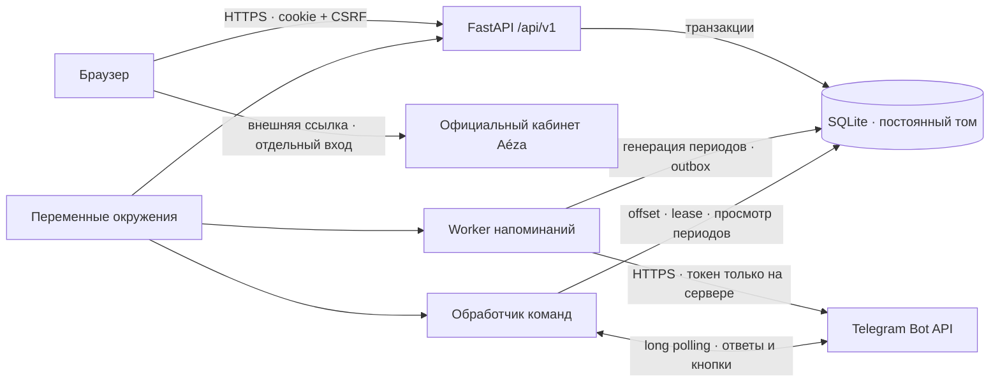

# Архитектура «Aéza · Контроль продлений»

## Границы системы

Приложение состоит из React-интерфейса, HTTP API на FastAPI, worker напоминаний, обработчика Telegram-команд и SQLite. Собранный интерфейс отдаёт тот же процесс FastAPI, поэтому браузеру не нужны междоменные запросы, публичные токены или отдельный адрес API. Фоновые процессы независимы: остановка командного бота не отключает напоминания. Для небольшого командного приложения SQLite позволяет обойтись без отдельного сервера базы. Перенос на PostgreSQL оправдан при нескольких хостах и значительной конкурентной записи.

Модуль предназначен для ручного учёта инфраструктурных продлений под брендом Aéza. Регулярный платёж представляет учитываемый расход на сервер, хостинг, домен или другую услугу; период — отдельный плановый срок с собственным снимком суммы и отметкой. Пользователь оплачивает услугу в официальном кабинете, затем фиксирует факт и дату в модуле. Учётные записи модуля независимы от кабинета Aéza.



Production-развёртывание предполагает HTTPS на доверенном reverse proxy. По умолчанию Docker публикует приложение только на `127.0.0.1:8000`. Публичная публикация требует настройки TLS, безопасного cookie и точного списка допустимых origin. Код рассчитан на один хост с локальным диском; файл SQLite нельзя размещать на сетевой файловой системе.

## Граница с кабинетом Aéza

Режим интеграции — `manual`. Ссылка на `https://my.aeza.ru/` открывает кабинет, но не передаёт в него сессию модуля и не выполняет платёж. Сервер модуля не получает баланс, счета, реальные подписки или состояние инфраструктуры из Aéza. Отметка оплаты, просрочка и прекращение учёта вычисляются из локальных данных и не управляют услугой у провайдера. Интеграционные SSO/API-заглушки для этих действий отсутствуют.

Модель сохраняет обязательный контракт кейса «Invoice Keeper». Технические имена `invoice-keeper`, `recurring-payments` и `payment-occurrences` остаются совместимыми с поставкой и OpenAPI. Пользовательские названия разделов могут говорить о продлениях без изменения семантики API. Поддерживается ежемесячное повторение; демопримеры доменных расходов условны и не моделируют годовой цикл регистратора.

## Предметная модель

- **Регулярный платёж** хранит название, сумму в минимальных единицах, валюту, исходную дату и исходное число месяца. Прекращение платежа — мягкое удаление: история остаётся, новые периоды и уведомления больше не создаются.
- **Период оплаты** хранит собственный срок, снимок названия/суммы/валюты и фактическую дату оплаты. Уникальность пары «регулярный платёж + срок» защищает от повторной генерации.
- **Пользователь** имеет роль обычного пользователя и хеш пароля. Администратор определяется окружением, его нельзя создать, изменить или удалить через управление пользователями.
- **Сессия** хранится на сервере. В браузер передаётся случайный идентификатор, а для изменяющих запросов используется отдельный CSRF-токен.
- **Outbox напоминаний** хранит единственное задание на период, состояние отправки и диагностические сведения о попытке. Выбор задания и захват выполняются транзакционно.
- **Состояние Telegram-обработчика** хранит offset обновлений и lease единственного poller для токена. Область состояния определяется SHA-256 токена; сам токен в эти таблицы не записывается.

Деньги считаются целыми минимальными единицами, без арифметики с `float`. Итоги по RUB, USD и EUR независимы: общего итога с неявной конвертацией нет.

## Даты и ежемесячное повторение

Деловая дата — календарная дата в часовом поясе из `.env`. Время хранения сессий и технических событий — UTC. Ввод даты оплаты и срок — `YYYY-MM-DD`, без неоднозначной интерпретации часового пояса в браузере.

Дата каждого месяца рассчитывается от исходного числа, а не от предыдущего укороченного месяца. Для платежа от 31 января получится 28/29 февраля и затем 31 марта. Если исходного числа в месяце нет, используется последний день месяца. Новый период создаётся независимо от того, оплачен ли предыдущий. Исходный срок периода не меняется при изменении фактической даты оплаты.

Просрочка считается по календарным дням:

- неоплаченный период: `max(0, сегодня − срок)`;
- оплаченный период: `max(0, фактическая дата − срок)`.

Оплата в день срока своевременна. При отмене оплаты фактическая дата очищается; исправление даты сразу пересчитывает просрочку. Фактическая дата в будущем не принимается.

## Изменение будущих условий

Дополнительный `PATCH /api/v1/recurring-payments/{id}` доступен администратору с CSRF и принимает ровно три обязательных поля: `name`, `amount`, `currency`. Дата начала изменений — первое число следующего месяца в `TIMEZONE`, возвращается как `effective_from`.

В одной транзакции обновляются значения серии и уже созданные неоплаченные периоды со сроком от `effective_from`. Текущий месяц, прошлое и оплаченные будущие периоды сохраняются полностью. Исходная дата, число месяца, указатель генерации и идентификаторы периодов не меняются. Ещё не созданные будущие периоды используют новые значения серии.

Если указатель генерации находится раньше `effective_from`, сервер отклоняет изменение с `409`: сначала нужно обновить список. Обычный GET создаст пропущенные текущие/прошлые периоды по старым условиям, после чего изменение можно повторить. Это защищает несозданную историю без изменения указателя внутри PATCH. Канонически одинаковые значения возвращаются без записи и аудита.

Для прекращённой серии или уже отправляемого напоминания затрагиваемого будущего периода возвращается `409` без частичных изменений. `BEGIN IMMEDIATE` не позволяет worker захватить такое задание между проверкой и обновлением. Состояния outbox, в том числе `sent` и `unknown`, не сбрасываются, повторная рассылка не запускается. Изменение условий сохраняется в журнале с прежней и новой суммой, валютами и датой начала.

## Напоминания и конкурентность

Worker самостоятельно проверяет сроки; открытая вкладка браузера для этого не нужна. Период становится кандидатом за три календарных дня до срока и остаётся кандидатом, если создан позже этого момента. Уже оплаченный период пропускается. После прекращения регулярного платежа его задания не должны отправляться.

Транзакции SQLite, ограничения уникальности и атомарный захват задания защищают от повторной генерации и параллельной обработки одним или несколькими процессами на том же хосте. Перед отправкой нужно повторно проверить, что период не оплачен и регулярный платёж активен. Изменение статуса и отправка уведомления могут конкурировать; гарантированно отменить сообщение, уже переданное внешнему сервису, нельзя.

### Граница гарантии «без дублей»

Локальная система способна гарантировать единственное задание на период и отсутствие повторной отправки после подтверждённого успеха. Telegram `sendMessage` не предоставляет прикладной ключ идемпотентности. При сетевом обрыве ответ может потеряться после принятия сообщения Telegram. Автоматический повтор такой неопределённой отправки может создать дубль; отказ от повтора может пропустить сообщение.

Реализация переводит неопределённый результат в `unknown`: timeout чтения/записи, некорректный ответ Telegram или истёкший lease после остановки процесса. Такие задания автоматически не отправляются повторно. `retry` используется для ошибки соединения до отправки либо явного отказа Telegram; применяется задержка с учётом `retry_after`. Проверка «без дублей» при демонстрации относится к штатным повторным проходам worker и подтверждённым доставкам; абсолютная гарантия exactly-once через внешний HTTP API технически недостижима.

Администратор проверяет `unknown` через `GET /api/v1/reminders` или логи worker, затем сверяет соответствующий период с сообщениями в чате. Диагностический API не возвращает токен Telegram. Автоматического повтора неопределённой доставки нет. Для просмотра состояния непосредственно в SQLite-клиенте используется запрос:

```sql
SELECT id, occurrence_id, state, last_error, sent_at
FROM reminder_outbox
WHERE state = 'unknown';
```

Подтверждённую доставку следует зафиксировать как `sent`; решение о ручном повторе принимается после проверки чата с осознанием остаточной неопределённости. Изменять записи нужно при остановленных API/worker и наличии резервной копии. Если подтверждения нет, сохранение `unknown` сознательно выбирает отсутствие возможного дубля ценой возможного пропуска напоминания.

## Командный Telegram-бот

`python -m backend.telegram_bot` выполняет long polling и отвечает на `/start`, `/menu`, `/summary`, `/payments`, `/upcoming`, `/overdue` и `/help`. Месячная сводка и список по умолчанию используют текущий месяц в `TIMEZONE`; кнопки позволяют выбрать другой месяц. Ближайшие платежи — неоплаченные со сроком сегодня и до даты через семь дней включительно. Просроченные — все неоплаченные периоды до сегодня. Списки разбиты по шесть записей, а кнопки редактируют исходное сообщение.

Перед чтением финансовых данных обработчик проверяет точное совпадение фактического chat ID с `TELEGRAM_CHAT_ID`. Для callback требуется исходное сообщение с допустимым чатом, а в личной переписке дополнительно проверяется отправитель. Обновления из других чатов и callback без чата игнорируются. Параметры кнопок проверяются сервером. Обращения ограничены по частоте.

Бот предоставляет просмотр без веб-сессии только подключённому чату. Он не подтверждает оплату и не управляет пользователями или регулярными платежами. Месячные запросы используют ту же предметную логику и транзакционную генерацию будущих периодов, что и API. Таким образом, просмотр может материализовать период, но не меняет финансовую отметку.

Таблицы `telegram_updates` и `telegram_pollers` хранят offset и lease обработчика. Offset фиксируется до любого ответа на принятое обновление. Повторный запуск продолжает чтение с сохранённой позиции; сбой между сохранением offset и ответом может привести к отсутствию ответа, без автоматического воспроизведения. Пользователь может отправить команду снова. Это отдельная гарантия от outbox напоминаний: команды не создают повторных заданий уведомления.

Lease допускает одного poller для токена в общей SQLite и продлевается heartbeat. Он действует только для процессов, использующих эту базу. Другие приложения с тем же токеном и отдельной базой должны быть остановлены или переведены на другой токен. Webhook автоматически не удаляется. Для корректного перехода с webhook на polling оператор сначала согласует конфигурацию.

Тексты профиля, команды и аватар поставляются в `assets/telegram/`. Скрипт `scripts/configure_telegram.py` публикует профиль отдельно от runtime: проверяет ожидаемый username и чат, применяет поля и сверяет тексты/команды. Режим `--dry-run` проверяет локальные файлы до чтения окружения и без сети. Публикация профиля не отправляет сообщения; настройки Telegram применяются по отдельности и не образуют одну транзакцию.

## API и доставка

Контракт версионируется префиксом `/api/v1`. Проверка аутентификации и роли находится в зависимостях API, а не только в интерфейсе. Сервер валидирует поля, длины, разрешённые валюты, даты, деньги и переходы состояния.

Исходная OpenAPI-спецификация поставляется в `openapi.json`; актуальная интерактивная документация доступна после входа на `/api/v1/docs`. Frontend собирается один раз в `frontend/dist`; API отдаёт SPA и статические ресурсы. Секреты не участвуют в сборке frontend.

Один Docker-образ используется тремя сервисами: `api`, `worker` и `bot`. Все читают окружение и работают с одним постоянным томом `invoice-data`. Контейнеры запускаются без root, с файловой системой только для чтения за исключением тома данных и временного каталога. Приложение не требует Redis, Celery или отдельной очереди для текущего масштаба.

## Расширение и эксплуатация

Для нескольких хостов следует заменить SQLite на PostgreSQL и реализовать захват outbox и lease poller через блокировку строк. Для новых каналов уведомлений можно сохранить период как источник события и добавить доставки по каналам с отдельной уникальностью. SMTP и произвольные webhook в обязательный объём не входят. Реализованные Telegram callbacks служат навигации и просмотру; подтверждение оплаты в Telegram не реализовано.

Резервная копия должна включать согласованный снимок SQLite. При активном WAL нельзя копировать только основной `.db` произвольным файловым копированием. Остановите API, worker и bot либо используйте SQLite backup API. При восстановлении сохраните прежние состояния outbox и offset Telegram, иначе возможно повторное уведомление о старых периодах или повторная обработка команд.
