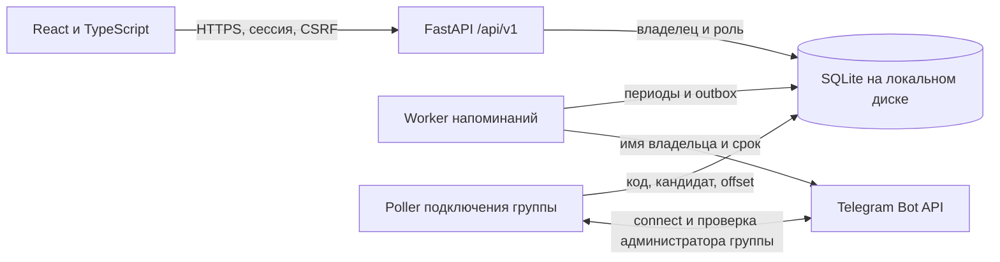

# Архитектура Aéza Регулярные платежи

Документ описывает командную версию, проверенную и развёрнутую 25 октября 2026. Факты прогонов и внешней доставки приведены в qa.md. Историческая версия общего веб-списка и финансового Telegram-меню не является текущей моделью.

## Границы и участники

Один экземпляр приложения обслуживает одну команду и одну корпоративную Telegram-группу. Aéza - сохранённый бренд решения кейса Invoice Keeper, а не источник счетов. Команда вводит любые регулярные расходы вручную. Отметка оплаты фиксирует факт со слов участника; приложение не списывает деньги, не сверяет банк и не управляет услугами провайдера.

В веб-панели обычный пользователь видит и полностью обслуживает только собственные расходы: создаёт серии, меняет будущие условия, прекращает учёт, отмечает и отменяет оплату, исправляет дату. Администратор видит все записи, управляет участниками и может создать расход от имени другого участника. Проверка владельца действует на сервере для списков, одиночных записей, изменений, истории и итогов.

В общей Telegram-группе видны имя владельца, название расхода, сумма, валюта и срок. Это согласованное раскрытие уведомлений команде, отдельно от личной области веб-панели. Бот не показывает финансовые списки по командам и не принимает финансовые изменения.

API отдаёт JSON и готовую сборку frontend с одного origin. В production перед ним стоит nginx с TLS; внутренний Uvicorn слушает loopback. API, worker и Telegram poller - независимые процессы с общей конфигурацией и SQLite. Остановка poller не должна останавливать веб-панель или уже подключённую доставку.

## Пользователи, приглашения и сессии

Администратор из `ADMIN_USERNAME` и `ADMIN_PASSWORD_HASH` синхронизируется при запуске. Управление им через API запрещено, включая самостоятельную смену пароля. Обычного участника администратор добавляет одним из двух способов:

1. `POST /api/v1/users` с логином, именем и заданным паролем.
2. `POST /api/v1/invitations` с логином и именем. Сервер выдаёт одноразовую ссылку `/#invite=TOKEN` со сроком 72 часа. Пользователь открывает её, задаёт собственный пароль и при успешном принятии получает новую сессию.

После принятия приглашения отдельный вход не обязателен. Это отличается от смены пароля: `POST /api/v1/auth/password` требует текущий и новый пароль, отзывает все сессии обычного пользователя и завершает текущий доступ; затем нужен повторный вход.

Токен приглашения хранится в виде хеша, исходная ссылка возвращается только при создании. Статусы: `active`, `accepted`, `revoked`, `expired`. Срок хранится как UTC-время. Просмотр приглашений и отзыв доступны администратору; открытые inspect/accept не дают права выбрать роль, другое имя или логин. Inspect/accept требуют точный Origin и ограничены по частоте; принятие повторно проверяет состояние внутри транзакции.

При удалении обычного пользователя все его серии, включая архивные, в одной транзакции переходят конфигурационному администратору. Идентификаторы серий и периодов, условия, даты, отметки и аудит сохраняются; доступ и сессии удалённого участника прекращаются. Это передача ответственности, а не удаление финансовой истории. Миграция проверена на копии и при обновлении действующей базы; роли и передача покрыты новым набором тестов.

## Предметная модель

- **Регулярный платёж** - правило ежемесячного расхода, его текущие условия, исходное число месяца и владелец. Ответ API содержит `owner_id`, `owner_name`, `can_manage`.
- **Период** - самостоятельный снимок названия, суммы и валюты с плановым сроком, ручной отметкой и фактической датой. Уникальна пара серия/срок.
- **Пользователь** - логин, отображаемое имя, хеш пароля и роль. Авторизация не строится на переданном клиентом `can_manage`: решение принимает сервер.
- **Приглашение** - назначенные администратором логин и имя, хеш одноразового токена, срок и состояние.
- **Привязка группы** - короткоживущий код, найденная группа и отдельно подтверждённое назначение. Таблицы telegram_link_requests и telegram_connection хранят запрос и подтверждённую привязку.
- **Outbox** - задание напоминания с периодом, состоянием и зафиксированным получателем Telegram. Текущая настройка группы не является динамическим адресом старого задания.
- **Сессии и техническое состояние poller** - серверные сессии, offset обновлений и lease единственного обработчика токена в общей базе.

Создатель и владелец - разные понятия. Администратор может ввести запись за участника; финансовая область определяется владельцем. Поля создателя и аудит не должны переписываться при передаче записей после удаления участника.

## Месячные периоды и деньги

Исходное число месяца сохраняется. Для 31 января срок февраля - 28 или 29, а марта снова 31. Расчёт не прибавляет фиксированные 30 дней. Новый период создаётся независимо от оплаты старого.

Деловая дата определяется `TIMEZONE`; технические события и сроки сессий хранятся в UTC. Плановый срок и фактическая дата - календарные даты `YYYY-MM-DD`. В день срока просрочки ещё нет. Для неоплаченного периода она равна максимуму из нуля и разницы сегодня/срок; для оплаченного - разницы фактическая дата/срок. Отмена оплаты очищает дату; дата в будущем не принимается.

Суммы хранятся целыми минимальными единицами, без арифметики `float`. RUB, USD и EUR суммируются отдельно. Обычный пользователь получает итоги только своих периодов, администратор - всех доступных ему записей.

Изменение названия, суммы и валюты серии действует с первого числа следующего месяца для неоплаченных будущих периодов. Текущий месяц, прошлое и уже оплаченные будущие периоды сохраняют снимки. Исходные сроки и график не меняются. Прекращение серии сохраняет историю, но не создаёт новые периоды и напоминания. Права на эти операции определяются владельцем или ролью администратора.

## Подключение группы

1. Администратор приложения в веб-панели создаёт код на 10 минут.
2. Добавляет бота в группу и отправляет `/connect@aezainkeep_bot CODE` от учётной записи, являющейся администратором этой Telegram-группы.
3. Poller проверяет группу и реальный статус отправителя через Telegram. Сам код не является окончательным разрешением доставки.
4. Найденная группа появляется в панели как кандидат. Администратор приложения отдельно подтверждает её.
5. Только подтверждённая группа получает уведомления.

Один человек может выполнять обе административные роли, но это две разные проверки. Ссылка на бота, `/start`, имя группы и legacy-личный чат не являются привязкой. Автоматического переноса прежнего личного чата нет. Финансовые команды `/summary`, `/payments`, `/upcoming`, `/overdue` и подтверждение оплаты в Telegram из новой модели исключены.

API: GET /api/v1/telegram/connection, POST /telegram/connection/request, POST /telegram/connection/confirm с request_id и DELETE /telegram/connection, все под префиксом /api/v1. Код живёт 10 минут, предыдущий незавершённый отзывается. Отключение отменяет pending/retry; при активной sending возвращается 409. Group → supergroup требует повторной привязки.

## Доставка и её границы

Worker проверяет неоплаченные активные периоды за три календарных дня до срока; добавленный позже период попадает в ближайшую проверку. Открытая вкладка не требуется. Сообщение содержит владельца, название платежа, сумму, валюту и срок. Это уведомление в общей группе, а не персональная рассылка каждому участнику и не подтверждение прочтения.

Постоянный outbox, ограничения уникальности и транзакционный захват защищают от обычных повторных заданий и параллельной отправки. Перед отправкой повторно проверяются актуальная отметка и активность серии. Конкретный получатель фиксируется в outbox; Уникальность включает occurrence_id, recipient_chat_id и delivery_scope. Подключение новой группы не воспроизводит всю старую просрочку: включаются текущие/будущие обязательства и поздно внесённые после подключения записи.

Telegram `sendMessage` не предоставляет используемого здесь прикладного ключа идемпотентности. Если ответ потерян после принятия сообщения, нельзя надёжно отличить доставку от недоставки. Неопределённая попытка получает `unknown` и автоматически не повторяется. Подтверждённые `sent` также не повторяются. Оператор сверяет неопределённый результат с группой; возможный пропуск честно предпочтён рискованному автоматическому дублю.

Сообщение, уже переданное Telegram, гарантированно отозвать после отметки оплаты нельзя. Подтверждение Bot API не означает уведомление или прочтение каждым участником: настройки клиента Telegram находятся вне модуля.

## Эксплуатация

SQLite подходит для небольшой команды на одном хосте с локальным диском. Сетевой файловый ресурс и распределённый кластер не поддерживаются. Для нескольких хостов потребуется другая база и согласованный захват заданий/lease; это отдельная работа.

Резервная копия включает финансовую историю, владельцев, приглашения, привязку группы, outbox и offset. Используется SQLite backup API либо остановка всех трёх процессов. При активном WAL копирование только основного `.db` может потерять изменения. Перед восстановлением старого снимка нужно сверить доставки, произошедшие после его создания, и не сбрасывать `sent`/`unknown` ради повторной рассылки.

